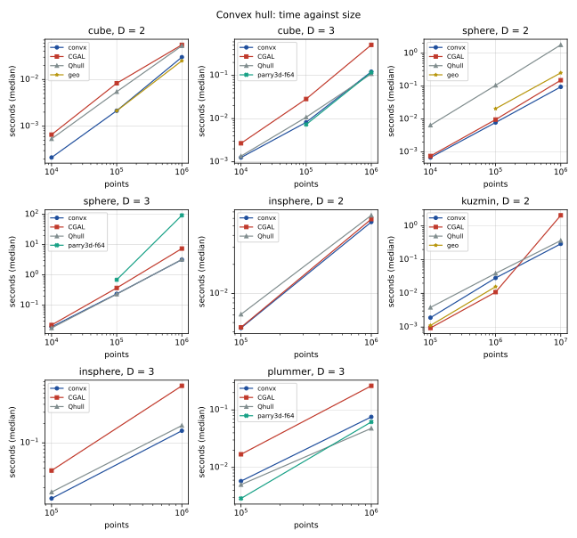
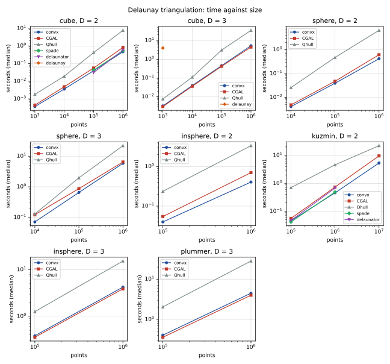
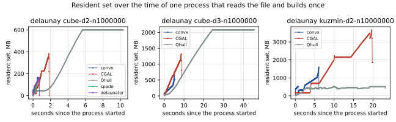

English | [日本語](comparison.ja.md)

# convx compared with Qhull, CGAL, and Rust crates

A report, not a test. Every row that was run is here, the ones where another library is faster or smaller among them. Nothing below is met or not met. The crate's own judgement against CGAL and Qhull is the parity run of [verification.md](verification.md): a fixed set of rows with a threshold, taken on every change that could move it. This report is taken once a release, on more data and more libraries, and judges nothing.

Taken on 2026-10-14, convx at `71b3069`. Every number is in [bench/summary.json](bench/summary.json).

## How it was run

| | |
| --- | --- |
| Machine | Intel Core i5-13400F (6 performance and 4 efficient cores, 16 threads), 48 GB |
| System | Windows 11, WSL2, Ubuntu 22.04.2, kernel 5.15.133.1 |
| Pinned | Every process to one core (core 2) |
| Load | The processor's total load, logged each minute through the run: 6% to 12% |
| Rust | 1.99.0, release profile |
| C++ | g++ 11.4.0, `-O3 -DNDEBUG`; GMP 6.2.1 |

| Library | Version | Arithmetic |
| --- | --- | --- |
| convx | `71b3069` | Exact signs of every predicate, from `f64` input |
| CGAL | 5.4 | Exact predicates on `f64` (`Epick` in D = 2 and 3, `Epick_d` above) |
| Qhull | 2020.2 | Floating point; facets within a tolerance are merged |
| `spade` | 2.15.1 | Exact predicates |
| `delaunator` | 1.1.0 | Robust orientation; equal points are not merged |
| `delaunay` | 0.8.2 | Exact predicates |
| `parry3d-f64` | 0.31.1 | Floating point |
| `geo` | 0.33.1 | Robust orientation |

The method is [benches/compare/README.md](../benches/compare/README.md), and the rows are [benches/compare/rows.txt](../benches/compare/rows.txt).

- **Time** is the construction of each library's output, timed inside its own process; reading the file is outside it. The libraries of a row take turns, round by round: 5 rounds of 3 builds when convx's first build takes under 1.5 s, otherwise 3 rounds of 1. Qhull builds once a process and reports its own "CPU seconds to compute hull (after input)". A table gives the median, and in parentheses its ratio to convx's median: above 1 the library is slower than convx, below 1 faster.
- **Peak memory** is the peak resident set of a process that reads the file and builds once, the median of three, from the kernel's `ru_maxrss` read by GNU time. It is the whole process: the points read from the file are in it for every library.
- **Memory over time** is the resident set of one such process, sampled every 2 ms.

What each library's timed section produces is not the same, and that is part of what is compared:

- **convx**: what `build()` returns. For a hull, its vertices, its facets with their vertex lists and neighbors, and every input point classified as a vertex, a point on the boundary, an interior point, or a duplicate. For a triangulation, its simplices with their neighbors.
- **CGAL**: the hull's surface, and the triangulation's cells and neighbors written to flat arrays (the same output as convx where CGAL has it).
- **Qhull**: the facets by their vertices, written to a file.
- **The Rust crates**: each one's own structure (the adapters are in `benches/compare/rust/`).

## The data

| Tier | What | Files |
| --- | --- | --- |
| rbox | Qhull's generator, seed 1: uniform in a cube, on a sphere, a rotated integer lattice, and points with companions within 1e-8 | D = 2 to 8, 10^3 to 10^6 points |
| PBBS | The distributions of the Problem Based Benchmark Suite: uniform in a ball, Kuzmin (D = 2), Plummer (D = 3), from PBBS's formulas | 10^5 to 10^7 points |
| Scans | The Stanford 3D Scanning Repository: Bunny, Dragon, Happy Buddha, Armadillo | 35,947 to 543,652 points |

The scans belong to the Stanford Computer Graphics Laboratory (http://graphics.stanford.edu/data/3Dscanrep/). They are downloaded by whoever runs the comparison and are not redistributed here.

## What each library does that the others do not

- **Dimensions.** convx builds hulls and triangulations in every dimension (D = 2 to 8 here). CGAL and Qhull do too (D = 2 to 8 here). `spade`, `delaunator`, and `geo` are D = 2 alone, `parry3d-f64` D = 3 alone, and `delaunay` D = 2 to 5.
- **Exactness.** convx, CGAL, and `spade` decide with exact signs; on the same points they report the same vertices and facets, simplices and neighbors. Qhull and `parry3d-f64` are floating point and can report fewer vertices, facets, or sites (the counts below).
- **Logical facets.** A facet of convx is every simplex of one exact hyperplane together: a lattice cube has 6 facets. CGAL reports the triangles of D = 3 (12), and on the lattice of D = 4, whose hull has 16 vertices, it reports 5,904. Qhull merges facets within a tolerance, which merges exactly coplanar ones and also nearly coplanar ones.
- **Cospherical sites.** convx and CGAL split a group of sites on one sphere into simplices; Qhull reports the group as one region (a lattice of D = 2 gives 9,801 squares from Qhull and 19,602 triangles from convx and CGAL).
- **Every input point accounted for.** convx's output says what each input point became: a vertex, a point on the boundary, an interior point, or a duplicate of which point. That is in its timed section and in no other library's.
- **Sites dropped.** Qhull's Delaunay triangulation leaves out sites it finds too close to others: of 10^5 Kuzmin sites, 57,938 are in its output.

## Results

The figures give the median time against the number of points for the kinds of data that have several sizes, and the resident set over the time of one process on three rows of 10^6 points or more.







In the memory figure a dot is a sample. A line without dots is a time in which no sample was read: the sampling reads `/proc`, which waits while the process maps memory.

### Where another library is faster

- **Hulls.** Another library is the fastest on 16 of the 42 hull rows. Qhull is faster on `cube` D3 at 10^6 (0.90), `sphere` D3 at 10^4 and 10^5 (0.92 and 0.98), `sphere` D5 (0.98), the lattices of D = 3 and 4 (0.97 and 0.43), Plummer in D3 (0.87 and 0.63), and the Dragon and Buddha scans (0.92 and 0.81). CGAL is faster on the lattice of D = 2 (0.38) and on Kuzmin points at 10^5 and 10^6 (0.50 and 0.38), and slower at 10^7 (7.01). `geo` is faster on `cube` D2 at 10^6 (0.83) and on Kuzmin points (0.59 and 0.55). `parry3d-f64` is faster on `cube` D3 (0.89 and 0.97) and on Plummer (0.50 and 0.82).
- **Delaunay.** CGAL is faster on 26 of the 38 Delaunay rows: by 0.85 to 0.99 on most rows of D = 2 to 4 below 10^6 points, by 0.67 on the lattice of D = 2, by 0.87 to 0.88 on `cube`, uniform in a ball, and Plummer at 10^6 in D3, and by 0.85 to 0.89 on the four scans. On `cube` D5 at 10^4 the two are level (1.00). Qhull is faster on the files of 10^3 points in D4 and D5 (0.91). `spade` and `delaunator` are faster on every row of D = 2 they are on (0.55 to 0.89), but for `delaunator` on 10^6 Kuzmin sites (1.08).
- **Memory.** Qhull's hulls take the least memory on 37 of the 42 hull rows. `spade` and `delaunator` take 56% to 59% of convx's memory for a triangulation of D = 2. Qhull's triangulations of 10^6 and 10^7 Kuzmin sites take a third and a fifth of convx's, and leave most sites out.

### Where convx is faster

- **Hulls.** convx is the fastest library on 26 of the 42 hull rows. Its largest margins are on CGAL in D ≥ 4 (2.6 to 22 times on `cube`), on Qhull for points on a sphere in D2 (9.6 to 19 times), and on `parry3d-f64` for points on a sphere in D3 (2.9 and 29 times).
- **Delaunay.** convx is faster than CGAL on 10^6 sites of D = 2 (1.19 to 1.26), on points on a sphere in D3 and D4 (1.10 to 2.84), on lattices of D = 3 and 4 (1.10 and 1.56), and on 10^7 Kuzmin sites (1.44). It is faster than Qhull on every Delaunay row but the two files of 10^3 points in D4 and D5.
- **Memory.** convx's triangulations take 53% to 75% of CGAL's peak, but on the lattices (88% to 94%), and 29% to 56% of Qhull's in D3 on files of 10^4 points or more.

### Time and peak memory

#### Convex hull, rbox: time

| Data | D | Points | convx | CGAL | Qhull | geo | parry3d-f64 |
| --- | ---: | ---: | ---: | ---: | ---: | ---: | ---: |
| `cube` | 2 | 10^4 | 0.21 ms | 0.66 ms (3.08) | 0.54 ms (2.51) |  |  |
| `cube` | 2 | 10^5 | 2.15 ms | 8.30 ms (3.87) | 5.47 ms (2.55) | 2.14 ms (1.00) |  |
| `cube` | 2 | 10^6 | 30.1 ms | 55.1 ms (1.83) | 52.5 ms (1.75) | 25.1 ms (0.83) |  |
| `cube` | 3 | 10^4 | 1.26 ms | 2.68 ms (2.13) | 1.35 ms (1.08) |  |  |
| `cube` | 3 | 10^5 | 8.22 ms | 28.5 ms (3.47) | 10.8 ms (1.31) |  | 7.32 ms (0.89) |
| `cube` | 3 | 10^6 | 122 ms | 511 ms (4.19) | 109 ms (0.90) |  | 118 ms (0.97) |
| `cube` | 4 | 10^4 | 5.04 ms | 43.0 ms (8.53) | 6.45 ms (1.28) |  |  |
| `cube` | 4 | 10^5 | 24.7 ms | 550 ms (22.26) | 30.7 ms (1.24) |  |  |
| `cube` | 5 | 10^4 | 49.4 ms | 208 ms (4.21) | 82.5 ms (1.67) |  |  |
| `cube` | 5 | 10^5 | 199 ms | 1.59 s (8.01) | 364 ms (1.83) |  |  |
| `cube` | 6 | 10^4 | 563 ms | 2.07 s (3.68) | 1.79 s (3.18) |  |  |
| `cube` | 7 | 10^3 | 841 ms | 3.05 s (3.63) | 2.45 s (2.91) |  |  |
| `cube` | 8 | 10^3 | 7.91 s | 20.68 s (2.61) | 31.33 s (3.96) |  |  |
| `sphere` | 2 | 10^4 | 0.68 ms | 0.75 ms (1.11) | 6.54 ms (9.63) |  |  |
| `sphere` | 2 | 10^5 | 7.88 ms | 9.67 ms (1.23) | 106 ms (13.48) | 20.7 ms (2.63) |  |
| `sphere` | 2 | 10^6 | 95.3 ms | 152 ms (1.60) | 1.80 s (18.94) | 255 ms (2.67) |  |
| `sphere` | 3 | 10^4 | 19.3 ms | 22.3 ms (1.15) | 17.8 ms (0.92) |  |  |
| `sphere` | 3 | 10^5 | 238 ms | 373 ms (1.57) | 233 ms (0.98) |  | 693 ms (2.92) |
| `sphere` | 3 | 10^6 | 3.21 s | 7.44 s (2.32) | 3.26 s (1.02) |  | 93.06 s (28.98) |
| `sphere` | 4 | 10^4 | 88.0 ms | 118 ms (1.34) | 90.4 ms (1.03) |  |  |
| `sphere` | 4 | 10^5 | 1.12 s | 1.21 s (1.09) | 1.25 s (1.12) |  |  |
| `sphere` | 5 | 10^4 | 799 ms | 980 ms (1.23) | 787 ms (0.98) |  |  |
| `sphere` | 6 | 10^4 | 6.60 s | 9.64 s (1.46) | 7.89 s (1.20) |  |  |
| `lattice` | 2 | 10^4 | 0.26 ms | 0.10 ms (0.38) | 0.44 ms (1.69) |  |  |
| `lattice` | 3 | 27,000 | 2.05 ms | 4.03 ms (1.97) | 1.99 ms (0.97) |  |  |
| `lattice` | 4 | 10^4 | 4.11 ms | 49.5 ms (12.02) | 1.76 ms (0.43) |  |  |
| `near` | 2 | 10^4 | 0.21 ms | 0.63 ms (3.02) | 0.51 ms (2.43) |  |  |
| `near` | 3 | 10^4 | 1.29 ms | 2.55 ms (1.98) | 1.51 ms (1.17) |  |  |
| `near` | 3 | 10^5 | 8.10 ms | 25.3 ms (3.12) | 10.4 ms (1.29) |  |  |

#### Convex hull, rbox: peak memory (MB)

| Data | D | Points | convx | CGAL | Qhull | geo | parry3d-f64 |
| --- | ---: | ---: | ---: | ---: | ---: | ---: | ---: |
| `cube` | 2 | 10^4 | 3.1 | 4.9 | 2.8 |  |  |
| `cube` | 2 | 10^5 | 7.6 | 10 | 5.3 | 7.4 |  |
| `cube` | 2 | 10^6 | 56 | 56 | 32 | 55 |  |
| `cube` | 3 | 10^4 | 3.5 | 5.5 | 2.8 |  |  |
| `cube` | 3 | 10^5 | 10 | 13 | 6.1 |  | 15 |
| `cube` | 3 | 10^6 | 101 | 96 | 42 |  | 126 |
| `cube` | 4 | 10^4 | 4.6 | 11 | 3.3 |  |  |
| `cube` | 4 | 10^5 | 13 | 56 | 7.6 |  |  |
| `cube` | 5 | 10^4 | 12 | 30 | 10 |  |  |
| `cube` | 5 | 10^5 | 30 | 132 | 25 |  |  |
| `cube` | 6 | 10^4 | 75 | 221 | 75 |  |  |
| `cube` | 7 | 10^3 | 103 | 226 | 104 |  |  |
| `cube` | 8 | 10^3 | 646 | 1515 | 650 |  |  |
| `sphere` | 2 | 10^4 | 3.9 | 5.2 | 5.0 |  |  |
| `sphere` | 2 | 10^5 | 13 | 13 | 29 | 8.0 |  |
| `sphere` | 2 | 10^6 | 104 | 80 | 298 | 64 |  |
| `sphere` | 3 | 10^4 | 9.9 | 12 | 7.4 |  |  |
| `sphere` | 3 | 10^5 | 73 | 79 | 53 |  | 119 |
| `sphere` | 3 | 10^6 | 713 | 734 | 505 |  | 1219 |
| `sphere` | 4 | 10^4 | 27 | 30 | 19 |  |  |
| `sphere` | 4 | 10^5 | 241 | 269 | 172 |  |  |
| `sphere` | 5 | 10^4 | 111 | 164 | 81 |  |  |
| `sphere` | 6 | 10^4 | 609 | 1087 | 450 |  |  |
| `lattice` | 2 | 10^4 | 3.1 | 4.8 | 2.8 |  |  |
| `lattice` | 3 | 27,000 | 4.6 | 6.5 | 3.5 |  |  |
| `lattice` | 4 | 10^4 | 4.0 | 13 | 2.8 |  |  |
| `near` | 2 | 10^4 | 3.2 | 5.0 | 2.8 |  |  |
| `near` | 3 | 10^4 | 3.9 | 5.6 | 2.9 |  |  |
| `near` | 3 | 10^5 | 10 | 13 | 6.5 |  |  |

#### Convex hull, PBBS: time

| Data | D | Points | convx | CGAL | Qhull | geo | parry3d-f64 |
| --- | ---: | ---: | ---: | ---: | ---: | ---: | ---: |
| `insphere` | 2 | 10^5 | 4.39 ms | 4.46 ms (1.02) | 6.09 ms (1.39) |  |  |
| `insphere` | 2 | 10^6 | 55.0 ms | 59.0 ms (1.07) | 64.5 ms (1.17) |  |  |
| `insphere` | 3 | 10^5 | 13.6 ms | 36.9 ms (2.73) | 17.0 ms (1.26) |  |  |
| `insphere` | 3 | 10^6 | 154 ms | 777 ms (5.03) | 186 ms (1.21) |  |  |
| `kuzmin` | 2 | 10^5 | 1.90 ms | 0.94 ms (0.50) | 3.83 ms (2.02) | 1.12 ms (0.59) |  |
| `kuzmin` | 2 | 10^6 | 28.6 ms | 10.9 ms (0.38) | 39.1 ms (1.37) | 15.8 ms (0.55) |  |
| `kuzmin` | 2 | 10^7 | 294 ms | 2.06 s (7.01) | 368 ms (1.25) |  |  |
| `plummer` | 3 | 10^5 | 5.78 ms | 16.9 ms (2.93) | 5.03 ms (0.87) |  | 2.89 ms (0.50) |
| `plummer` | 3 | 10^6 | 75.6 ms | 262 ms (3.47) | 47.8 ms (0.63) |  | 61.8 ms (0.82) |

#### Convex hull, PBBS: peak memory (MB)

| Data | D | Points | convx | CGAL | Qhull | geo | parry3d-f64 |
| --- | ---: | ---: | ---: | ---: | ---: | ---: | ---: |
| `insphere` | 2 | 10^5 | 7.6 | 9.3 | 5.3 |  |  |
| `insphere` | 2 | 10^6 | 55 | 53 | 32 |  |  |
| `insphere` | 3 | 10^5 | 10 | 15 | 6.3 |  |  |
| `insphere` | 3 | 10^6 | 106 | 98 | 43 |  |  |
| `kuzmin` | 2 | 10^5 | 7.5 | 8.1 | 4.8 | 7.4 |  |
| `kuzmin` | 2 | 10^6 | 55 | 42 | 25 | 54 |  |
| `kuzmin` | 2 | 10^7 | 527 | 644 | 308 |  |  |
| `plummer` | 3 | 10^5 | 10 | 13 | 6.2 |  | 14 |
| `plummer` | 3 | 10^6 | 96 | 96 | 41 |  | 129 |

#### Convex hull, scans: time

| Data | D | Points | convx | CGAL | Qhull | parry3d-f64 |
| --- | ---: | ---: | ---: | ---: | ---: | ---: |
| `bunny` | 3 | 35,947 | 6.71 ms | 11.4 ms (1.69) | 7.91 ms (1.18) | 8.43 ms (1.26) |
| `dragon` | 3 | 437,645 | 50.6 ms | 119 ms (2.35) | 46.6 ms (0.92) | 126 ms (2.50) |
| `buddha` | 3 | 543,652 | 83.7 ms | 170 ms (2.03) | 68.1 ms (0.81) |  |
| `armadillo` | 3 | 172,974 | 20.6 ms | 52.4 ms (2.54) | 21.9 ms (1.06) |  |

#### Convex hull, scans: peak memory (MB)

| Data | D | Points | convx | CGAL | Qhull | parry3d-f64 |
| --- | ---: | ---: | ---: | ---: | ---: | ---: |
| `bunny` | 3 | 35,947 | 6.1 | 8.2 | 4.4 | 9.7 |
| `dragon` | 3 | 437,645 | 50 | 45 | 20 | 61 |
| `buddha` | 3 | 543,652 | 67 | 54 | 24 |  |
| `armadillo` | 3 | 172,974 | 21 | 20 | 8.8 |  |

#### Delaunay, rbox: time

| Data | D | Points | convx | CGAL | Qhull | spade | delaunator | delaunay |
| --- | ---: | ---: | ---: | ---: | ---: | ---: | ---: | ---: |
| `cube` | 2 | 10^3 | 0.47 ms | 0.40 ms (0.85) | 1.64 ms (3.46) |  |  | 461 ms (971.79) |
| `cube` | 3 | 10^3 | 3.14 ms | 2.81 ms (0.90) | 7.00 ms (2.23) |  |  | 3.72 s (1186.47) |
| `cube` | 4 | 10^3 | 52.3 ms | 49.8 ms (0.95) | 47.5 ms (0.91) |  |  | 134.71 s (2574.59) |
| `cube` | 5 | 10^3 | 422 ms | 452 ms (1.07) | 386 ms (0.91) |  |  |  |
| `cube` | 2 | 10^4 | 4.87 ms | 4.51 ms (0.93) | 17.9 ms (3.69) |  |  |  |
| `cube` | 2 | 10^5 | 51.1 ms | 50.5 ms (0.99) | 365 ms (7.14) | 40.4 ms (0.79) | 28.0 ms (0.55) |  |
| `cube` | 2 | 10^6 | 532 ms | 656 ms (1.23) | 5.01 s (9.43) | 471 ms (0.89) | 446 ms (0.84) |  |
| `cube` | 3 | 10^4 | 34.3 ms | 30.9 ms (0.90) | 87.5 ms (2.55) |  |  |  |
| `cube` | 3 | 10^5 | 369 ms | 338 ms (0.91) | 1.98 s (5.35) |  |  |  |
| `cube` | 3 | 10^6 | 4.22 s | 3.68 s (0.87) | 24.56 s (5.81) |  |  |  |
| `cube` | 4 | 10^4 | 672 ms | 646 ms (0.96) | 757 ms (1.13) |  |  |  |
| `cube` | 5 | 10^4 | 7.04 s | 7.04 s (1.00) | 7.50 s (1.07) |  |  |  |
| `sphere` | 2 | 10^4 | 4.72 ms | 4.37 ms (0.92) | 22.9 ms (4.84) |  |  |  |
| `sphere` | 2 | 10^5 | 41.1 ms | 39.3 ms (0.95) | 314 ms (7.63) |  |  |  |
| `sphere` | 2 | 10^6 | 395 ms | 477 ms (1.21) | 4.59 s (11.64) |  |  |  |
| `sphere` | 3 | 10^4 | 66.5 ms | 117 ms (1.76) | 107 ms (1.61) |  |  |  |
| `sphere` | 3 | 10^5 | 615 ms | 828 ms (1.35) | 1.54 s (2.51) |  |  |  |
| `sphere` | 3 | 10^6 | 5.31 s | 5.86 s (1.10) | 18.21 s (3.43) |  |  |  |
| `sphere` | 4 | 10^4 | 850 ms | 2.42 s (2.84) | 1.20 s (1.41) |  |  |  |
| `lattice` | 2 | 10^4 | 7.76 ms | 5.21 ms (0.67) | 34.8 ms (4.49) |  |  |  |
| `lattice` | 3 | 27,000 | 119 ms | 130 ms (1.10) | 840 ms (7.09) |  |  |  |
| `lattice` | 4 | 10^4 | 444 ms | 693 ms (1.56) | 1.59 s (3.58) |  |  |  |
| `near` | 2 | 10^4 | 5.06 ms | 4.66 ms (0.92) | 24.6 ms (4.86) |  |  |  |
| `near` | 3 | 10^4 | 35.0 ms | 34.6 ms (0.99) | 128 ms (3.66) |  |  |  |
| `near` | 3 | 10^5 | 375 ms | 366 ms (0.98) | 1.93 s (5.15) |  |  |  |

#### Delaunay, rbox: peak memory (MB)

| Data | D | Points | convx | CGAL | Qhull | spade | delaunator | delaunay |
| --- | ---: | ---: | ---: | ---: | ---: | ---: | ---: | ---: |
| `cube` | 2 | 10^3 | 3.1 | 5.1 | 2.9 |  |  | 9.8 |
| `cube` | 3 | 10^3 | 3.5 | 6.0 | 4.1 |  |  | 25 |
| `cube` | 4 | 10^3 | 6.0 | 11 | 9.4 |  |  | 144 |
| `cube` | 5 | 10^3 | 21 | 37 | 39 |  |  |  |
| `cube` | 2 | 10^4 | 5.3 | 8.0 | 7.6 |  |  |  |
| `cube` | 2 | 10^5 | 32 | 43 | 62 | 18 | 18 |  |
| `cube` | 2 | 10^6 | 277 | 384 | 599 | 163 | 162 |  |
| `cube` | 3 | 10^4 | 11 | 17 | 19 |  |  |  |
| `cube` | 3 | 10^5 | 87 | 136 | 209 |  |  |  |
| `cube` | 3 | 10^6 | 823 | 1312 | 2078 |  |  |  |
| `cube` | 4 | 10^4 | 41 | 68 | 80 |  |  |  |
| `cube` | 5 | 10^4 | 228 | 391 | 449 |  |  |  |
| `sphere` | 2 | 10^4 | 5.0 | 8.1 | 8.4 |  |  |  |
| `sphere` | 2 | 10^5 | 27 | 40 | 61 |  |  |  |
| `sphere` | 2 | 10^6 | 233 | 354 | 591 |  |  |  |
| `sphere` | 3 | 10^4 | 7.9 | 14 | 21 |  |  |  |
| `sphere` | 3 | 10^5 | 57 | 101 | 185 |  |  |  |
| `sphere` | 3 | 10^6 | 539 | 961 | 1827 |  |  |  |
| `sphere` | 4 | 10^4 | 23 | 45 | 97 |  |  |  |
| `lattice` | 2 | 10^4 | 7.8 | 8.3 | 9.5 |  |  |  |
| `lattice` | 3 | 27,000 | 33 | 36 | 36 |  |  |  |
| `lattice` | 4 | 10^4 | 39 | 45 | 44 |  |  |  |
| `near` | 2 | 10^4 | 5.3 | 8.2 | 8.4 |  |  |  |
| `near` | 3 | 10^4 | 11 | 18 | 22 |  |  |  |
| `near` | 3 | 10^5 | 87 | 133 | 206 |  |  |  |

#### Delaunay, PBBS: time

| Data | D | Points | convx | CGAL | Qhull | spade | delaunator |
| --- | ---: | ---: | ---: | ---: | ---: | ---: | ---: |
| `insphere` | 2 | 10^5 | 52.0 ms | 51.5 ms (0.99) | 224 ms (4.31) |  |  |
| `insphere` | 2 | 10^6 | 527 ms | 663 ms (1.26) | 3.20 s (6.07) |  |  |
| `insphere` | 3 | 10^5 | 369 ms | 341 ms (0.92) | 1.20 s (3.24) |  |  |
| `insphere` | 3 | 10^6 | 4.25 s | 3.71 s (0.87) | 15.04 s (3.54) |  |  |
| `kuzmin` | 2 | 10^5 | 57.6 ms | 53.2 ms (0.92) | 588 ms (10.22) | 39.2 ms (0.68) | 43.9 ms (0.76) |
| `kuzmin` | 2 | 10^6 | 577 ms | 686 ms (1.19) | 4.13 s (7.15) | 456 ms (0.79) | 626 ms (1.08) |
| `kuzmin` | 2 | 10^7 | 6.34 s | 9.10 s (1.44) | 21.04 s (3.32) |  |  |
| `plummer` | 3 | 10^5 | 383 ms | 350 ms (0.91) | 1.94 s (5.07) |  |  |
| `plummer` | 3 | 10^6 | 4.37 s | 3.84 s (0.88) | 26.59 s (6.09) |  |  |

#### Delaunay, PBBS: peak memory (MB)

| Data | D | Points | convx | CGAL | Qhull | spade | delaunator |
| --- | ---: | ---: | ---: | ---: | ---: | ---: | ---: |
| `insphere` | 2 | 10^5 | 31 | 43 | 53 |  |  |
| `insphere` | 2 | 10^6 | 276 | 384 | 505 |  |  |
| `insphere` | 3 | 10^5 | 92 | 136 | 172 |  |  |
| `insphere` | 3 | 10^6 | 823 | 1314 | 1696 |  |  |
| `kuzmin` | 2 | 10^5 | 32 | 43 | 41 | 18 | 18 |
| `kuzmin` | 2 | 10^6 | 275 | 384 | 93 | 162 | 162 |
| `kuzmin` | 2 | 10^7 | 2699 | 3669 | 528 |  |  |
| `plummer` | 3 | 10^5 | 90 | 137 | 206 |  |  |
| `plummer` | 3 | 10^6 | 824 | 1315 | 2082 |  |  |

#### Delaunay, scans: time

| Data | D | Points | convx | CGAL | Qhull |
| --- | ---: | ---: | ---: | ---: | ---: |
| `bunny` | 3 | 35,947 | 137 ms | 121 ms (0.89) | 400 ms (2.93) |
| `dragon` | 3 | 437,645 | 1.88 s | 1.65 s (0.88) | 7.92 s (4.22) |
| `buddha` | 3 | 543,652 | 2.42 s | 2.05 s (0.85) | 12.13 s (5.01) |
| `armadillo` | 3 | 172,974 | 692 ms | 613 ms (0.89) | 2.27 s (3.28) |

#### Delaunay, scans: peak memory (MB)

| Data | D | Points | convx | CGAL | Qhull |
| --- | ---: | ---: | ---: | ---: | ---: |
| `bunny` | 3 | 35,947 | 33 | 53 | 65 |
| `dragon` | 3 | 437,645 | 395 | 613 | 792 |
| `buddha` | 3 | 543,652 | 501 | 758 | 1189 |
| `armadillo` | 3 | 172,974 | 156 | 239 | 303 |


### Where the outputs' counts differ

A hull's counts are its vertices and its facets (CGAL: triangles in D = 3, simplices above; `parry3d-f64`: triangles). A triangulation's are its distinct sites and its simplices (Qhull: regions). Rows not listed agree.

| Operation | Data | D | Points | Counts |
| --- | --- | ---: | ---: | --- |
| hull | `cube` | 2 | 100,000 | convx 26 / 26; CGAL 26 / 26; Qhull 25 / 25; geo 26 / 26 |
| hull | `cube` | 2 | 1,000,000 | convx 32 / 32; CGAL 32 / 32; Qhull 24 / 24; geo 32 / 32 |
| hull | `cube` | 3 | 100,000 | convx 183 / 362; CGAL 183 / 362; Qhull 178 / 345; parry3d-f64 180 / 356 |
| hull | `cube` | 3 | 1,000,000 | convx 304 / 604; CGAL 304 / 604; Qhull 279 / 520; parry3d-f64 283 / 562 |
| hull | `cube` | 4 | 100,000 | convx 742 / 4,193; CGAL 742 / 4,193; Qhull 741 / 4,162 |
| hull | `cube` | 5 | 100,000 | convx 2,274 / 48,608; CGAL 2,274 / 48,608; Qhull 2,274 / 48,495 |
| hull | `cube` | 6 | 10,000 | convx 1,870 / 170,250; CGAL 1,870 / 170,250; Qhull 1,870 / 170,190 |
| hull | `cube` | 7 | 1,000 | convx 623 / 221,260; CGAL 623 / 221,260; Qhull 623 / 221,247 |
| hull | `cube` | 8 | 1,000 | convx 767 / 1,309,711; CGAL 767 / 1,309,711; Qhull 767 / 1,309,651 |
| hull | `sphere` | 2 | 100,000 | convx 99,999 / 99,999; CGAL 99,999 / 99,999; Qhull 99,997 / 99,997; geo 99,999 / 99,999 |
| hull | `sphere` | 2 | 1,000,000 | convx 999,872 / 999,872; CGAL 999,872 / 999,872; Qhull 998,720 / 998,720; geo 999,872 / 999,872 |
| hull | `lattice` | 3 | 27,000 | convx 8 / 6; CGAL 8 / 12; Qhull 8 / 6 |
| hull | `lattice` | 4 | 10,000 | convx 16 / 8; CGAL 5,904 / 25,559; Qhull 16 / 8 |
| hull | `near` | 3 | 100,000 | convx 176 / 348; CGAL 176 / 348; Qhull 173 / 339 |
| hull | `buddha` | 3 | 543,652 | convx 6,181 / 12,357; CGAL 6,181 / 12,358; Qhull 6,181 / 12,357 |
| delaunay | `cube` | 2 | 100,000 | convx 100,000 / 199,972; CGAL 100,000 / 199,972; Qhull 100,000 / 199,963; spade 100,000 / 199,972; delaunator 100,000 / 199,972 |
| delaunay | `cube` | 2 | 1,000,000 | convx 1,000,000 / 1,999,966; CGAL 1,000,000 / 1,999,966; Qhull 1,000,000 / 1,999,861; spade 1,000,000 / 1,999,966; delaunator 1,000,000 / 1,999,966 |
| delaunay | `cube` | 3 | 100,000 | convx 100,000 / 671,796; CGAL 100,000 / 671,796; Qhull 100,000 / 671,787 |
| delaunay | `cube` | 3 | 1,000,000 | convx 1,000,000 / 6,748,017; CGAL 1,000,000 / 6,748,017; Qhull 1,000,000 / 6,747,463 |
| delaunay | `sphere` | 2 | 10,000 | convx 10,000 / 9,998; CGAL 10,000 / 9,998; Qhull 10,000 / 9,985 |
| delaunay | `sphere` | 2 | 100,000 | convx 100,000 / 99,999; CGAL 100,000 / 99,999; Qhull 99,999 / 99,996 |
| delaunay | `sphere` | 2 | 1,000,000 | convx 1,000,000 / 1,000,126; CGAL 1,000,000 / 1,000,126; Qhull 999,782 / 999,556 |
| delaunay | `sphere` | 3 | 10,000 | convx 10,000 / 30,054; CGAL 10,000 / 30,054; Qhull 10,000 / 29,493 |
| delaunay | `sphere` | 3 | 100,000 | convx 100,000 / 301,399; CGAL 100,000 / 301,399; Qhull 100,000 / 300,338 |
| delaunay | `sphere` | 3 | 1,000,000 | convx 1,000,000 / 3,014,104; CGAL 1,000,000 / 3,014,104; Qhull 1,000,000 / 3,004,242 |
| delaunay | `sphere` | 4 | 10,000 | convx 10,000 / 128,732; CGAL 10,000 / 128,732; Qhull 10,000 / 128,524 |
| delaunay | `lattice` | 2 | 10,000 | convx 10,000 / 19,602; CGAL 10,000 / 19,602; Qhull 10,000 / 9,801 |
| delaunay | `lattice` | 3 | 27,000 | convx 27,000 / 146,334; CGAL 27,000 / 146,334; Qhull 27,000 / 24,389 |
| delaunay | `lattice` | 4 | 10,000 | convx 10,000 / 157,464; CGAL 10,000 / 157,464; Qhull 10,000 / 6,561 |
| delaunay | `near` | 2 | 10,000 | convx 10,000 / 19,977; CGAL 10,000 / 19,977; Qhull 9,525 / 18,502 |
| delaunay | `near` | 3 | 10,000 | convx 10,000 / 64,177; CGAL 10,000 / 64,177; Qhull 9,914 / 63,208 |
| delaunay | `near` | 3 | 100,000 | convx 100,000 / 650,949; CGAL 100,000 / 650,949; Qhull 99,194 / 641,412 |
| delaunay | `kuzmin` | 2 | 100,000 | convx 100,000 / 199,994; CGAL 100,000 / 199,994; Qhull 57,938 / 83,898; spade 100,000 / 199,994; delaunator 100,000 / 199,994 |
| delaunay | `kuzmin` | 2 | 1,000,000 | convx 1,000,000 / 1,999,993; CGAL 1,000,000 / 1,999,993; Qhull 81,805 / 115,418; spade 1,000,000 / 1,999,993; delaunator 1,000,000 / 1,999,993 |
| delaunay | `kuzmin` | 2 | 10,000,000 | convx 10,000,000 / 19,999,993; CGAL 10,000,000 / 19,999,993; Qhull 39,772 / 56,200 |
| delaunay | `plummer` | 3 | 100,000 | convx 100,000 / 675,750; CGAL 100,000 / 675,750; Qhull 100,000 / 675,747 |
| delaunay | `plummer` | 3 | 1,000,000 | convx 1,000,000 / 6,765,810; CGAL 1,000,000 / 6,765,810; Qhull 1,000,000 / 6,764,920 |
| delaunay | `buddha` | 3 | 543,652 | convx 543,524 / 3,867,976; CGAL 543,524 / 3,867,976; Qhull 543,523 / 3,867,954 |

## Not compared

- **The `delaunay` crate in D = 5.** One process of three builds of 1,000 points had not finished after 81 minutes, and the row was run without it. In D = 2 to 4 it took 0.46 s, 3.7 s, and 135 s for 1,000 points.
- **Crates not compared**, chosen as the main ones and not as a survey: `qhull` (bindings to Qhull, which is here itself), `chull`, `tritet`, `startin`, `voronoice`, `voronator`.
- **Voronoi diagrams.** No other library here builds the same output; convx's diagram is its Delaunay triangulation and a linear solve per vertex.
- **Threads.** Every library here was run on one core. CGAL has parallel triangulations; convx builds sequentially.

## Taking it again

```sh
bash benches/compare/setup.sh <commit>
for tier in rbox pbbs scans; do bash benches/compare/data/make.sh $tier; done
cd ~/convx-compare
python3 <repo>/benches/compare/runner.py <repo>/benches/compare/rows.txt results.jsonl
python3 <repo>/benches/compare/publish.py results.jsonl <repo>/docs/bench <meta.json>
```

`publish.py` writes `summary.json` and the figures. The data, about 950 MB, is removed after a run.
