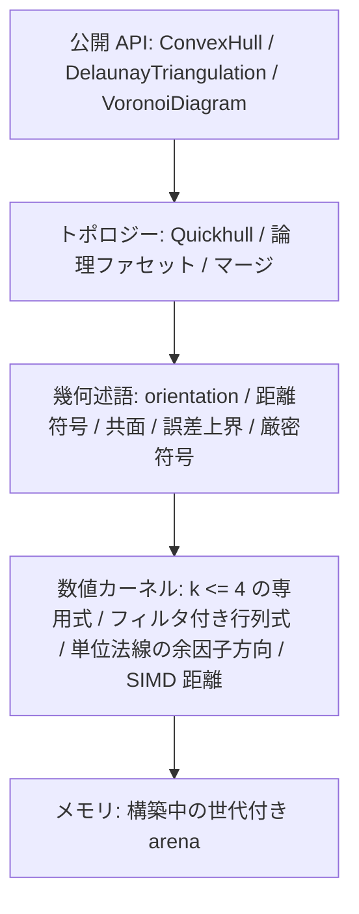

# convx 設計仕様

純 Rust で書いた、N 次元の凸包、Delaunay 三角形分割、Voronoi 図のライブラリである。正しさは、幾何述語の符号、その符号にもとづくトポロジーの判定、その判定にしたがうデータ構造の更新、の順に積み上がる。公開する結果どうしは、正規化した論理ファセットで比較する。

この文書は、実装に入る前に仕様を固定しておくためのものである。速度の倍率の目標は、逐次処理のコアができてから Qhull を測って決める。

---

## 1. 述語が符号を決める

入力の `f64` は、そのビット列が表す値をそのまま座標として扱い、述語の前に平行移動もスケーリングもしない。丸めを伴う変換をすると、厳密にゼロになる位置がずれてしまうからである。例外として、丸めが入らない変換を一つだけ認める（#179、#589）。入力のすべての座標に同じ 2 の冪を掛ける変換で、その積がどの座標でも正確に表せる場合に限る。この変換はすべての行列式に正の 2 の冪を掛けるだけなので、符号は一つも変わらず、スケーリング後の座標で構築しても同じ厳密な問題を解いたことになる。変換は受け付けの前に一度だけ行い、最大の座標が 1 から大きく離れているとき（サイトでは `2^12` を両側に超えるとき、凸包の点では `2^64`、$D = 2$ の凸包では `2^300` を超えるとき）に、それを $[1, 2)$ に収める。巨大な座標と微小な座標が混在していて、一つのスケールでは丸めが入ってしまう入力は、スケーリングせずにそのまま構築する。結果として座標を公開するもの（凸包の平面、Voronoi 図の頂点）は、入力の元の座標から計算する。#179 で最初に認めた、フィルタの中で述語ごとに成分をスケーリングする方法は、試したうえで取り下げた。述語を二度実行することになり、しかも述語の前後の処理は微小な座標のまま動いていたためである。

誤差が生じるのは、述語の式を評価するときの丸めだけである。各述語は `f64` ではなく `Sign` を返す。公開関数は符号を受け取りも返しもしないので、`Sign` は API の型ではなく、クレート内部の型である（#596）。

```rust
enum Sign {
    Negative,
    Zero,
    Positive,
}
```

点が共面であるとは、orientation が `Zero` になることをいう。点がファセットのどちら側にあるかは、その面のアフィン独立な点に対象の点を加えた orientation で決まる。点が共球であるとは、持ち上げた orientation が `Zero` になることをいう。フィルタは、実際に行った加算・減算・乗算の列について、絶対誤差の上界を持つ。その上界が FMA の丸めを考慮していないときは、FMA への縮約を使わない。計算値の絶対値が上界を超えていればその符号を採用し、超えていなければ同じ多項式の厳密な符号で決め直す。計算値と上界がともに 0 で、式が恒等的に 0 ではない場合も、厳密な符号で決め直す。アンダーフローで 0 になった値を、ゼロと確定することはない。厳密評価のアルゴリズムは仕様では固定しない。自前のコードでも、依存リストにないクレートを加えてもよく、返す符号がこの多項式の符号と一致していればよい。失敗するのは厳密評価の作業領域を確保できないときだけで、そのときは `ExactEvaluationExhausted` を返す。この作業領域はスレッドごとに持つ。スタック上の整数に収まらない行列式は、ヒープ上の整数で厳密に評価する段が引き受ける。この段は、最初に必要になった呼び出しでバッファを確保し、以後の呼び出しではそれを再利用する（#185）。そうした行列式を一度でも評価したスレッドは、終了するまでそのバッファを持ち続ける。通常の `Vec` の確保に失敗した場合は、Rust の既定どおりアボートする。条件が悪いこと自体は、失敗として扱わない。

公開 API には許容誤差のパラメータがない。共面かどうかは、距離の厳密な符号がゼロかどうかだけで判定する。

符号の向きは、次のように定める。

- 点が $x \cdot n + \mathrm{offset} > 0$ を満たすなら、その点は平面の外側にある。
- 平面の式は $x \cdot n + \mathrm{offset} = 0$ で、$n$ は外向きの単位法線である。
- 向きは行列式の厳密な符号で判定する。公開平面（第5節）で計算した $x \cdot n + \mathrm{offset}$ は、この判定には使わない。
- 幾何次数 $k$ は、引数に渡す点の数から 1 を引いた値で、凸包の次元 $D$ とは関係しない。$k \le 6$（点 7 個まで）では、符号を段階的に決める。
  - 第一段では、行列式を `f64` で評価する。$k \le 5$ では専用の式を使い、その式について事前に導いた誤差上界で符号を確定する。$k = 6$ では、実行時に上界を計算するフィルタ付きの浮動小数点行列式を使う。$k = 6$ ではこちらのほうが専用式より速いことを、測定で確かめた（#350）。
  - 第一段で確定しないときは、第二段で専用式を double-double 演算で評価し、その段の事前の上界で確定する。double-double の値は、二つの `f64` を足し合わせずに組として持つ表現である。積は Dekker の方法で正確に分割するので FMA は要らず、結果はターゲットの命令セットに依存しない。この段が受け付けるのは、アンダーフローもオーバーフローも起こさずに証明が成り立つ範囲の座標だけで、それ以外の入力は厳密な符号に任せる。
  - どちらの段でも確定しないときに限り、厳密な符号で決める。その間に別の段は挟まない。
  - 第二段の前（実行時のフィルタを使う場合はその前）に、ある座標の列がすべて零になる行列は、その時点でゼロと決める。すべての点がその座標で原点と同じ値を持ち、方向を表す行があればその成分も零である場合がこれに当たる。`f64` では `a - b` が零になるのは `a == b` のときだけなので、この判定は厳密である。誤差上界ではゼロを確定できないが、座標軸に平行な超平面上の入力では、ゼロになる符号の多くがこの形をとる（#368）。
  - $k \le 5$ では、続けて第二段の前に、第一段の演算そのものが厳密だった場合にゼロを確定する。条件は三つある。行列式に現れる差がすべて丸めなしで得られていること（減算の誤差項が零であること）。差がすべて一つの 2 の冪の整数倍で、それらの最下位の 1 のビットから最上位までの幅が $w$ ビットであること。そして、向きの判定では $\lceil \log_2 k! \rceil + k w \le 52$、$D \le 4$ の持ち上げた向きの判定では $\lceil \log_2 k! \rceil + 2 + (k + 1) w \le 52$ を満たすこと。このとき式に現れる和と積はすべて、その単位で数えて $2^{53}$ 未満の整数になり、どれも丸められないので、計算結果が零なら行列式も零である。これは上界による判定ではなく、演算が厳密であることによる証明である。零でない値は第二段に任せる。格子、画素やボクセルの座標、二進の桁数が少ない座標がこの条件を満たす。格子の Delaunay 構築では、こうしたゼロを数万回求める（#614）。

  式をどう展開するかは実装に任せる。各上界は、実装する箇所でオーバーフローとアンダーフローも含めて証明する。普段通る経路では、どの積にも非正規化数の因子が現れないようにする。$k$ が 6 を超えるときはフィルタ付きの浮動小数点行列式で評価し、値が上界以内のときだけ厳密な符号で決める。
- 公開する単位法線は、点の数によらず、ファセットの余因子ベクトル（辺の並びに単位行 $e_j$ を加えた行列式 $c_j$ を並べたもの）を外向きにそろえて単位化したものである。距離走査に使う作業用の法線も同じ向きを持つ。この向きは、述語のフィルタで誤差上界とともに確定させる。上界が $10^{-10}$ を超えるときは厳密に計算し、単位化のときに一度だけ丸める。Householder QR は使わない。こうして確定した向きは QR で求めた法線より正確で、誤差上界も保証される（ADR 0002）。ファセットの点が 5 個以上のときは、その数を $n$ として、$(n-1) \times n$ の辺行列 $E$ を一度だけ消去し、すべての余因子を求める。最初の $n - 1$ 列を部分ピボット付きの Gauss 消去で処理すると、$s$ 回の行交換のあとで $[T \mid u]$ が得られる。$T$ は上三角である。ある行の定数倍を別の行に足しても $E$ の最大小行列式は変わらず、行交換をするとその符号が反転する。$T x = u$ のとき $E$ は $(-x, 1)$ を零に写すので、Cramer の公式から $c = (-1)^s \det T \cdot (-x, 1)$ が成り立つ。フィルタは、消去、$x$ の後退代入、$\det T$ との積のすべてについて誤差上界を追跡するので、各 $c_j$ は、別々の行列式として計算した場合と同じように自分の上界を持つ。符号を確定できない除数が現れたときは余因子を確定させず、向きを厳密に計算する。法線の向きは、ファセットの頂点の並びに対して orientation が外側を示す符号になるほうに選ぶ。この向きは、行列式を評価せずに誤差上界から証明する。余因子の厳密な単位方向を $u = c/|c|$ とし、ベクトル $v$ が $|v - u| = e < 1$ を満たすとすると、$|v| \ge 1 - e$ であり、$v \cdot u = (|v|^2 + 1 - e^2)/2 \ge 1 - e > 0$ となる。向きの符号は $v \cdot c$ の符号だから、$v$ は正の側にある。確定した方向の誤差は $10^{-10}$ 以下、厳密に計算した場合は $D \cdot 2^{-49}$ 以下なので、作業用の法線にも公開する法線にもこの証明が当てはまる。厳密な方向は、厳密な整数で求めた余因子の上位 64 ビットを残して `f64` に丸め、計算したノルムで割って求める。切り捨てによる方向のずれは $2\sqrt{D} \cdot 2^{-63}$ 以下、丸めは $2u$ 以下、ノルムは $(D/2 + 1)u$ 以下、割り算は $u$ 以下である。合わせて誤差は $(D/2 + 5)u$ 以下になり、$D \cdot 2^{-49} = 16 D u$ を下回る（実測の最大は $2.7u$、`docs/bench.md`）。

SIMD の距離走査は、誤差上界によって厳密に内側にあると証明できる点を、述語の対象から外すために使う（枝刈り）。可視性と外側性を決める「ファセットに対する点の側」は、ファセットの頂点を外向きの順に並べてその点を加えた orientation の厳密な符号で決まる。作業用の距離を使えば、orientation を評価する前にその符号を証明できることがある。ただし、証明できるのは厳密な符号だけである。計算した距離 $w$ が、保証付きのしきい値 $(\mathrm{slope} \cdot l + \mathrm{floor})(1 + 4u)$ をどちらかの側に越えていれば、厳密な平面までの真の距離も同じ厳密な符号を持ち、orientation も同じ符号になる。そうでなければ、符号がゼロの場合も含めて orientation で決める。このしきい値は、枝刈りに使うものと同じである。$|n - u^*| \le \tau$ と $w$ の丸めによって $|w - (x - o) \cdot u^*|$ が抑えられるので、証明はどちらの側にも成り立つ。$\tau$ は、作業用の法線を保証した方法から得る。フィルタ付きの余因子で保証した法線なら、その余因子が $\tau$ も保証する。厳密な方向を一度だけ丸めた法線なら、その誤差上界 $D \cdot 2^{-49}$ を $\tau$ とする。そのため、フィルタ付きの消去でピボットを保証できないファセット、たとえばピボットがちょうどゼロになる整数の辺を持つファセットにも、枝刈りに使う平面がある。保証付きの作業用法線には、必ず枝刈りのしきい値が付く。$D = 3$ と $D = 4$ では、座標の大きさが $2^{100}$ 以下で、辺の成分がゼロか $[2^{-100}, 2^{100}]$ の範囲にあるファセットについて、作業用法線と枝刈りのしきい値を固定長の経路で求める。この範囲では、一般の経路で行う 2 の冪によるスケーリングが厳密で、保証付きの方向とその誤差のビットを一つも変えないので、固定長の経路でも同じビットが得られる。余因子が法線を保証するとき、余因子が保証する $\tau$ はその誤差に等しい。同じ長さと同じ商を計算し直すので、ずれの項がちょうどゼロになるからである。それ以外のファセットには一般の経路を使い、保証付きの作業用法線を持たないファセットでは orientation だけを使う。どの経路でも、得られる符号は同じである。

次元も述語の符号で決める。基底に点を一つずつ加えていき、新しい点が既存の基底に対して厳密な符号でゼロになるなら、その方向は空間を広げない。

---

## 2. 層



距離の数値計算と、符号を確定する述語は分けて実装する。前者は速さを優先してよく、トポロジーを決めるのは後者である。

---

## 3. 入力を受け付ける条件

`dim == 0` なら `NonPositiveDimension` で失敗する。この検査は、除算や剰余を行う前に済ませる。次元は $D \ge 1$ であればよく、上限は設けない。次元が高いと厳密評価のビット長と時間が伸びるが、そのコストは呼び出し側が負うものとし、次元だけを理由に拒否することはしない。入力の点の数は `u32::MAX` 以下でなければならず、超えた場合は重複を除く前に `TooManyPoints` で失敗する。公開するインデックスは `u32` のままである。有効な点番号は最大でも `u32::MAX - 1` なので、`u32::MAX` はどの点番号とも重ならない欠番として使える。

`points.len()` が $D$ の倍数でなければ `LengthMismatch` で失敗する。座標は行優先の `&[f64]` で渡し、検証を通ったあとは `chunks_exact(D)` で点を取り出す。点 `i` が占める範囲 `i*D .. (i+1)*D` は、必ずスライスの長さに収まる。有限でない座標が一つでもあれば `NonFiniteCoordinate { index }` で失敗し、その入力全体を受け付けない。`index` には、入力順で最初に有限でない座標を持つ点の番号を入れる。

その後の前処理は、次の順に行う。

1. 有限でない座標の拒否
2. 重複の集約
3. 個数の検査
4. ランクの検査
5. 構築

重複かどうかは `==` で判定するので、`-0.0` と `+0.0` は同じ点になる。`to_bits` や `total_cmp` で等しさを判定してはならない。順序を付けて代表を選ぶ実装では、比較の前に符号付きゼロを `+0.0` にそろえる。等しい点の代表には、最小の入力インデックスを選ぶ。代表の数が $D + 1$ 未満なら `InsufficientPoints { actual, required }` で失敗する。`actual` は代表の数、`required` は $D + 1$ である。

代表が $D + 1$ 個以上あっても、アフィン次元が $D$ に満たなければ `DegenerateDimension { actual_dim, spanning_points }` で失敗する。呼び出し側が低い次元に射影して扱いたい場合は、返された `spanning_points` を使えばよい。`spanning_points` は、代表のインデックスを昇順にたどり、アフィン次元を厳密に増やす点だけを集めた列で、長さは $\textit{actual\_dim} + 1$ になる。この列は、辞書順で最小の基底である。

失敗しうる関数は、凸包・Delaunay 三角形分割・Voronoi 図の構築と `ConvexHull::planes()` で、どれも一つのエラー型 `Error` を返す。`Error` には `#[non_exhaustive]` を付ける。後のバージョンでバリアントを加えても呼び出し側のコードは壊れないが、クレートの外で `match` するときはワイルドカードの分岐が必要になる（#596）。

```rust
#[non_exhaustive]
pub enum Error {
    NonPositiveDimension,
    LengthMismatch { len: usize, dim: usize },
    /// 入力順で最初に、有限でない座標を持つ点の番号。
    NonFiniteCoordinate { index: usize },
    TooManyPoints { actual: usize },
    InsufficientPoints { actual: usize, required: usize },
    DegenerateDimension {
        actual_dim: usize,
        spanning_points: Vec<u32>,
    },
    /// 凸包のトポロジーは決まったが、公開する平面を有限な f64 で表せなかった。
    /// build() ではなく ConvexHull::planes() が返す。この平面はトポロジーの判定には使わない。
    NonFiniteFacetPlane,
    /// Delaunay のトポロジーは決まったが、外心を有限な f64 で表せなかった。
    /// 幾何的な退化ではない。凸包と Delaunay の構築はこのエラーを返さない。
    NonFiniteCircumcenter,
    /// 厳密評価の作業領域を確保できなかった。
    /// 通常の Vec の確保に失敗した場合は、Rust の既定どおりアボートする。
    ExactEvaluationExhausted,
}
```

### インデックスの分割

構築に成功すると、入力のどのインデックスにも行き先が一つ決まる。

`representative` は長さ n の `Vec<u32>` で、`i` が代表なら `representative[i] == i`、重複なら代表のインデックスを指す。常に `representative[representative[i]] == representative[i]` が成り立つ。

代表の集合は、次の三つのリストに分ける。どれも昇順で、互いに重ならず、合わせると代表の集合全体になる。

| リスト            | 中身                                                                           |
| :---------------- | :----------------------------------------------------------------------------- |
| `vertices`        | 凸包の極点。取り除くと凸包が変わる点                                           |
| `coplanar_points` | 境界上にあるが極点ではない点。インデックスだけを持ち、どのファセットに属するかは持たない |
| `interior_points` | 凸包の内部にある点                                                             |

この三つのリストは `ConvexHull` だけが持つ。`representative` は凸包、Delaunay、Voronoi のどの結果にも付ける。

Delaunay と Voronoi のサイトは代表の集合全体であり、内部点も、頂点でない境界上の点も含む。ビット列が異なり `==` でも等しくない点は、どれほど近くても一つにまとめない。

分類は、外側の点をすべて取り込み、共面で隣り合う単体を論理ファセットにまとめたあとで行う。ここで使う距離の符号は、その面のアフィン独立な $D$ 点に対象の点を加えた orientation であり、公開平面との内積は使わない。

- いずれかの論理ファセットへの距離が厳密に正なら、その点は外側にある。構築に成功した結果には、外側の点は残らない。
- すべてのファセットへの距離が厳密に負なら、その点は内部点である。
- 内部点であることは、構築の途中で先に証明してよい。構築がある点を候補から落としたとき、調べた符号がすべて厳密に負なら、その点は内部点であり、論理ファセットに対する符号は求めない。調べる面は二通りある。一つは初期単体のすべてのファセットで、もう一つは、点が可視ファセットの外側集合にあったとき、または可視ファセットだけに属する頂点だったときに、その挿入で作るすべての新しい単体である。カリングで内側と証明された点は、厳密に負として数える（§6）。前者の場合、点は初期単体の厳密な内部にあり、凸包が大きくなっても内部にとどまる。後者の場合を示す。挿入を計画した時点の凸包を $P$、apex を $a$ とし、$Q = \mathrm{conv}(P \cup \{a\})$ とおく。新しい単体はどれも $a$ を含み、その支持平面は $a$ と地平線のリッジを通る。それらの平面の閉じた内側の共通部分は、$a$ を頂点とし $P$ に向かう錐である。点 $p$ はそのすべての平面の厳密な内側にあるので、$a$ から $p$ に向かう半直線は $P$ のある点 $y$ を通る。$p$ はある可視ファセット $f$ の厳密な外側にあった。apex も $f$ の厳密な外側にあり、$y$ は $P$ の点なので $f$ の平面上か内側にある。半直線が一つの平面と交わるのは一度だけなので、$p$ は $a$ と $y$ を結ぶ開線分の上にあり、$p \in Q$ となる。残るファセット $g$ については、$a$（$g$ から見えない）と $y$ がどちらも $g$ の平面上か内側にあるので、$p$ も同じである。$p$ がその平面上に乗るのは、$a$ と $y$ がどちらも平面上にあるときに限る。$a$ が $g$ の平面上にあるなら、その平面上にある $Q$ の面は頂点 $a$ を含むので、同じ外側を持つ新しい単体がその平面上にある。すると $p$ はその単体に対して符号 0 となり、仮定に反する。したがって $p$ は $Q$ のすべてのファセットの平面の厳密な内側、つまり $Q$ の内部にある。挿入はその時点の凸包に対して計画し、最終的な凸包は $Q$ を含むので、$p$ は最終的な凸包の内部にある。三つ目として、$P$ の頂点 $v$ のうち、それを含む単体がすべて可視であるものは、挿入のあと複体の頂点ではなくなる。そのような $v$ も、その挿入でできるすべての新しい単体に対して符号が厳密に負なら、内部点である。$v \in P$ なので、残るファセット $g$ に対して $v$ は $g$ の平面上か内側にある。平面上にあるとすると、その平面上にある $P$ の面は $v$ を含み、その面は同じ平面上の境界単体で覆われる。境界は単体複体なので、$v$ を含む単体は $v$ を頂点に持つ。その単体は $g$ と同じ平面と外側を持つので、頂点 $a$ に対する符号も $g$ と同じになり、挿入のあとも残る。すると $v$ は残る単体の頂点になり、仮定に反する。したがって $v$ は $Q$ のすべてのファセットの平面の厳密な内側、つまり $Q$ の内部にある。二つ目の場合と同じく、最終的な凸包は $Q$ を含むので、$v$ は最終的な凸包の内部にある。符号に一つでも 0 が含まれていた点は、以下の規則で分類する。
- 距離が厳密にゼロのファセットがあり、ほかのファセットへの距離が負かゼロなら、その点は境界上にある。距離がゼロの面が複数あるときは、面ごとに判定する。
- 構築は、点が平面上にあることを記録してよい。どの単体も平面の番号を持つ。新しい単体は、地平線のリッジを挟んだ反対側のファセットに対する apex の厳密な符号がゼロならそのファセットの番号を引き継ぎ、そうでなければ新しい番号を取る。初期単体のファセットはどれも新しい番号を取る。番号を引き継ぐ場合、地平線のリッジと apex は反対側のファセットの支持平面上にあり、新しい単体はアフィン独立な $D$ 個の頂点を持つので、その平面は新しい単体の支持平面でもある。挿入前の凸包はどちらの単体に対しても内側にあり、その平面には含まれないので、外側の向きも同じになる。したがって、同じ番号を持つ単体はどれも同じ支持平面と同じ外側を持ち、一つの点がそれらに対して持つ符号は一つに決まる。点の単体に対する厳密な符号がゼロのとき、その点と単体の番号の組を記録する。記録があれば、その点が同じ番号の単体に対して後で持つ符号はゼロとわかるので、評価しない。同じ平面上の二つの単体が異なる番号を持つことはありうる。記録のない組は、これまでどおり評価する。記録はどの符号も変えないので、外側集合も、内部点の証明も、公開する値も変わらない。分類が共面の面のために作る部分凸包も通常の構築なので、同じように記録する。$D = 1$ と $D = 2$ は挿入で単体を作らないので、何も記録しない。
- 分類は記録を起点にしてよい。点 $p$ について、最終的な複体の単体が持つ番号の記録があり、その単体の論理ファセットを $F$ とする。$p$ から $F$ への距離はゼロである。$p$ は凸包に属するので、$p$ からの距離がゼロのファセットは $p$ を含むファセットであり、それは $p$ を含む凸包の最小の面 $G$ を含むファセットに等しい。$G$ を含む面の全体は、ある多面体の面束をなす。多面体のファセットはリッジを通じてつながっているので、$G$ を含む二つのファセットは、$G$ を含むファセットの列で結ばれ、列の隣り合うファセットはリッジを共有する。リッジを共有する二つの論理ファセットは隣接している。そのリッジを覆う境界単体は、二つのファセットの単体に一つずつ載るからである。したがって、$F$ から始めて、$p$ からの距離がゼロの隣接論理ファセットだけをたどれば、距離がゼロのファセットすべてに到達する。それ以外のファセットへの距離は厳密に負であり、その符号は評価しない。最終的な複体の単体の番号についての記録がない点は、すべての論理ファセットに対して調べる。
- $D = 3$ では、記録のある点がファセットの内側にあると判定できれば、このたどりを省いてよい。記録の起点となる論理ファセットを $F$ とし、$F$ の頂点のうち 8 方向それぞれで最も遠い点を結んだ多角形を $W$ とする。$W$ は、頂点を座標平面に射影し、$D = 2$ の除外に使う多角形と同じ方法で作る。射影では、$F$ の最初の単体を射影した orientation がゼロにならない座標を落とすので、$F$ の平面は座標平面に一対一に写り、厳密な内側の関係も保たれる。フィルタ付きの orientation によって $W$ のすべての辺の厳密な左側にあると証明された点は、$W$ の相対内部にある。$W$ の頂点は $F$ の点なので $W \subseteq F$ であり、その点は $F$ の相対内部にある。$F$ の相対内部の点を通る凸包の支持平面は $F$ 全体を含むので、$F$ の平面しかない。したがって、その点から他のファセットへの距離は厳密に負である。また、その点は $F$ の他の点の正の重みによる凸結合なので、極点ではない。その点は `coplanar_points` に入れ、$F$ の極点の候補にも加えない。加えなくても $F$ の極点は変わらない。$W$ の内側と証明できなかった点は、上のとおりにたどる（#504）。
- 距離がゼロの面では、その頂点集合を $V$ とし、点が $\mathrm{conv}(V)$ の外側にあるかどうかを、入力座標のままの orientation で判定する。使うリッジは、その面の現在の単体分割のうち、この面の単体ただ一つだけに属するものである。その単体の頂点のうちリッジに含まれないものを $a$ とし、$V$ に含まれない極点のうちインデックスが最小のものを $q$ とする。点 $p$ がそのリッジの外側にあるのは、$\mathrm{orient}(R, p, q)$ と $\mathrm{orient}(R, a, q)$ の符号がどちらもゼロでなく、互いに逆のときである。$D = 1$ にはこのリッジがなく、端点以外の境界点は生じない。点が一つ以上の面で外側にあれば `vertices` に入れ、外側だった面すべての頂点集合に加える。どの面でも外側でなければ `coplanar_points` に入れる。
- 単体複体の頂点も同じ基準で分類する。挿入した時点では極点だった頂点が、その後の挿入で辺や面の相対内部に入ってしまうことがある。厳密な可視判定は、共面の隣の単体を消さないからである。面の頂点集合は、その面の単体複体の頂点と距離がゼロの点を合わせたものの極点である。極点でなくなった単体複体の頂点は `coplanar_points` に入れる。
- 面の極点は、その面の点を一つ下の次元に射影した凸包の頂点として求める。射影では、面が垂直にならない軸を一つ落とす。その凸包の面も同じ方法で求める。一回の構築の中で、面の極点は一度しか求めない。極点はその面の候補点（入力インデックスの昇順）と一緒に保持し、複数のファセットが共有する面ではそれを読み出して使う。点集合の極点はその集合だけで決まるので、公開する結果は変わらない。一つ下の次元の凸包は、頂点を求めるためだけに作る。
- 頂点がすべて極点である単体一つだけからなる面を除き、すべての面を、極点をインデックス順に置いていく placing triangulation で分割する。それまでに置いた点のアフィン次元を上げる点は、現在のすべての単体と結ぶ。次元を上げない点は、極点なので、それまでの点の凸包の外側にある。そのような点は、自分が厳密に外側にある境界リッジのすべてと結ぶ。外側かどうかは、現在のアフィン包の中での厳密な orientation で判定し、リッジの残りの頂点とその点がリッジの両側に厳密に分かれるときに外側とする。隣接関係は、分割し直した単体から計算し直す。点が平面を張る場合（$D = 3$ の凸包の面と、$D = 2$ の Delaunay の共球グループ）は、同じ分割を点の周回順から読み取る。極点は厳密に凸の位置にあるので、最初の三点より後に置く点が外側になる境界リッジはちょうど一つで、それは先に置いた点のうち周回順でその点の両隣にあたる二点を結ぶ辺である。インデックスの大きい点から順に周回から外していくと、外すときの両隣がその二点になる。すべての点をすべての境界リッジと比べると、面の点の数の二乗に比例する手間がかかる（#533、#534）。そこで、点が三次元以上を張り、複体が三次元以上に達したあとも多くの点が残っている場合は、各境界リッジに、共有する面を挟んだ隣のリッジを持たせる。これは最後の次元だけでなく、複体が達する各次元で行う。次元を上げる点が来たら探索を打ち切り、複体をその点と結んで境界を集め直し、続く点は新しい次元で探索する（#565）。点は凸の位置にあるので、ある点が外側になるリッジどうしは、それらの面を通してつながっている。一つ見つければ、残りはそこからたどれる。最初の一つは、直前に置いた点のリッジから、`f64` で計算した高さの順に探す。高さは、リッジの超平面から点までの距離を、複体の内側の一点の深さを単位として測ったものである。高さが等しいリッジどうしは、リッジの頂点のうち点に最も近いものまでの距離の順に並べる。この順序は探索の順番を決めるだけで、結果には影響しない。取り出したリッジはどれも厳密な orientation で判定し、探索が終わるのは、点が外側になるリッジに着いたときか、リッジが尽きたときに限る。したがって、得られる単体とその順序は、すべてのリッジを比べた場合と同じである（#540）。
- 二つの面が、単体でない低次元の面を共有するとき、その面の切り方が両側で一致しないと、境界の単体複体は閉じない。placing triangulation を面に制限すると、同じ順序で置いたその面の placing triangulation になるので、どの面でも切り方が一致する。頂点を加えた面だけを辞書順最小の基底から分割し直す方法では、この一致は保証されない。

---

## 4. 単体とメモリ

$D$ 次元の凸包のファセットは $(D-1)$-単体であり、頂点を $D$ 個、隣接ファセットを $D$ 個、$D$ 次元の法線を持つ。3 次元なら、ファセットは頂点 3 個の三角形である。

Delaunay は、第7節の逐次挿入によって、$D$ 次元で頂点 $D+1$ 個の単体を直接作る。凸包のファセットの規則は使わない。

```rust
/// 構築中の単体ファセット。D はエンジンの次元。
struct Simplex {
    vertices: Vec<u32>,   // 長さ D
    neighbors: Vec<FacetId>, // 長さ D。各リッジを挟んで隣接するファセット
    normal: Vec<f64>,     // 長さ D。構築中の作業用法線
    offset: f64,
    group: GroupId,       // 論理ファセット。構築中だけの u32
    flags: u32,           // tombstone と予約ビット
}
```

`GroupId` は構築中にだけ使う `u32` で、公開する型にはしない。

公開する番号は、削除済みの要素を詰めた `u32` の添字である。`FacetId` の世代は、構築中のダングリング参照を防ぐためだけに使う。論理ファセットの平面はグループが持ち、単体ごとの作業用法線とは別に保存する。

arena は、チャンク単位で世代を持つインデックスである。構築は一つのスレッドが点を一つずつ挿入し、その場でデータを書き換える（第6節）。論理グループのまとめ方は、Union-Find でも、構築後に作り直す方法でもよい。

$D = 1$ では、ファセットは端点一つで、隣接リストは空にする。二つの端点がそれぞれ論理ファセットになり、体積は両端の座標の差の絶対値 $|x_{\max} - x_{\min}|$ である。

---

## 5. 論理ファセット

点を挿入している間は、境界を単体複体のまま扱う。すべての点を挿入し終えてから、共有するリッジの両側が厳密に共面になっている単体だけを、一つの論理ファセットにまとめる。挿入の途中ではまとめない。まとめたあとで、第3節の距離ゼロの分類を行う。単体でない面は、第3節の placing triangulation で分割する。

同じ支持平面上でつながっている境界は、一つの論理ファセットになる。凸多面体を一つの支持平面で切ってできる面は、一つしかないからである。点が頂点になるか、頂点でない境界上の点になるか、内部点になるかは、第3節の分類で決まる。

公開する形は、どの次元でも同じである。論理ファセットは要素ごとの `Vec` を持たない。`ConvexHull` がすべてのファセットの頂点列と隣接を平坦な配列にまとめて持ち、個々のファセットは借用ビューで公開する（第9節）。ファセットの平面は、別のビュー `planes()` で公開する。番号はファセットと共通で、最初に使うときに計算する。

```rust
pub struct Facets<'a> { /* ConvexHull を借用する */ }

impl<'a> Facets<'a> {
    pub fn len(&self) -> usize;
    pub fn is_empty(&self) -> bool;
    /// 公開ファセット番号で引く。範囲外の番号には None を返す。
    pub fn get(&self, facet: u32) -> Option<Facet<'a>>;
    /// 公開番号の順。
    pub fn iter(&self) -> impl ExactSizeIterator<Item = Facet<'a>> + 'a;
}

#[derive(Clone, Copy)]
pub struct Facet<'a> { /* ConvexHull を借用する */ }

impl<'a> Facet<'a> {
    /// 昇順の極点。
    pub fn vertices(&self) -> &'a [u32];
    /// 隣接ファセット番号の集合。昇順。
    pub fn neighbors(&self) -> &'a [u32];
}

pub struct Planes<'a> { /* ConvexHull を借用する */ }

impl<'a> Planes<'a> {
    pub fn len(&self) -> usize;
    pub fn is_empty(&self) -> bool;
    /// 公開ファセット番号で引く。範囲外の番号には None を返す。
    pub fn get(&self, facet: u32) -> Option<Plane<'a>>;
    /// 公開ファセット番号の順。
    pub fn iter(&self) -> impl ExactSizeIterator<Item = Plane<'a>> + 'a;
}

#[derive(Clone, Copy)]
pub struct Plane<'a> { /* ConvexHull を借用する */ }

impl<'a> Plane<'a> {
    /// 長さ D。外向き単位ベクトル。
    pub fn normal(&self) -> &'a [f64];
    /// 平面 x·n + offset = 0 の offset。
    pub fn offset(&self) -> f64;
}
```

$D = 1$ と $D \ge 3$ では、ファセットを頂点列の辞書順に並べ、その順の番号を公開番号とする。$D = 2$ のファセットは、境界を一周する辺である。一周は最小の頂点から反時計回りにたどり、ファセット $i$ はその $i$ 番目と $i+1$ 番目の頂点を結ぶ。最後のファセットは、最後の頂点と最初の頂点を結ぶ。第6節の構築は、始点の位置を除けばこの一周の順のまま凸包を残すので、番号付けのためのソートは要らない。ファセットの頂点列は、どの次元でも昇順である。`neighbors()` は隣接ファセットの番号を昇順に並べたもので、配列の位置は共有リッジとは対応しない。共有リッジは、二つのファセットの頂点集合の共通部分のうち、アフィン次元が $D-2$ になる面であり、リッジの頂点列は公開しない。$D \ge 3$ では、隣接番号の昇順は、相手のファセットの頂点列の辞書順と一致する。$D = 2$ では、ファセット $i$ に隣接するのは、ファセットの数を法としてファセット $i - 1$ と $i + 1$ である。

どの値を `build()` で計算し、どの値を最初に使うときに計算するかは、それぞれの値が何を必要とするかで決める。

- `build()` は、代表点、点を頂点・頂点でない境界上の点・内部点に分けた結果、各ファセットの頂点列、境界単体、頂点の座標を計算する。点の分類には入力の座標が要るが、結果は入力の座標を保持しない。共面のファセットの頂点列を決めるには、その上にある点が要る。分割し直すファセットの境界単体には、厳密な符号が要る（第3節）。
- $D = 2$ では、境界を一度だけ一周し、公開順のまま、各ファセットの頂点の組と隣接の組、各境界単体を書き込む。どれも長さが決まっているので、リストに開始位置は要らず、並べ替えも行わない。
- $D = 1$ と $D \ge 3$ では、`build()` は分類が残した順と番号のままファセットとその隣接を保持し、公開番号は最初に使うときに計算する。ファセット番号を読む最初の呼び出しが、頂点列を並べ、隣接リストと各境界単体のファセット番号を付け替え、凸包はその結果を保持する。該当する呼び出しは `facets()`、`planes()`、`triangulation()`、`volume()`、`boundary_cycle()`、比較である。番号付けは `build()` が計算したものを並べ替えて付け替えるだけなので、失敗することはなく、`Result` も返さない。
- 平面（後述）と、境界の単体複体の公開順（`triangulation()`）は、これまでどおり最初に使うときに計算する。

すべての値を読む呼び出し側にとっては、以前 `build()` で計算していたものを一度だけ計算する点で変わりはない。

平面は、そのファセットの頂点から作る。インデックスの組を辞書順に調べ、最初にアフィン独立になる $D$ 点を選ぶ。厳密な符号がゼロになる組は飛ばして、次の組に進む。述語に渡す座標は、入力のビット列のままである。公開平面は、次の手順で作る。

1. 第1節で確定した余因子方向を法線とする。厳密に計算する場合に限り、座標を一様に 2 の冪でスケーリングしてから求める。スケーリングで方向は変わらない
2. 単位長にする
3. 誤差上界から証明した orientation に符号を合わせ、内側が負になるようにする
4. offset は、基底の最初の点 $r$ を使って $-n \cdot r$ とする

公開する単位法線 $n$ は、平面を作った $D$ 点の余因子ベクトル $c$ を内側が負になる向きにそろえて単位化した $\hat c = c / \lVert c \rVert$ から、ユークリッド距離で $10^{-10}$ 以内にある（$D \le 56294$ のとき）。

$$
\lVert n - \hat c \rVert_2 \le \varepsilon \le 10^{-10}
$$

この上限は第1節から導かれる。公開する法線は確定した方向そのものであり、真の $\hat c$ から誤差上界 $\varepsilon$ 以内にある。$\varepsilon$ は、フィルタで確定した方向では $10^{-10}$ 以下、厳密に計算した場合は $D \cdot 2^{-49}$ で、$D \le 56294$ ならどちらも $10^{-10}$ 以下になる。法線は平面を作った $D$ 点だけで決まり、構築中の単体の頂点の並びには依存しない。平面はトポロジーに影響しない。バージョンをまたいで値が一致することも約束しない。

`build()` は平面を計算しない。`planes()` を最初に呼んだときに、すべてのファセットの平面を計算して凸包の中に保持し、以後の呼び出しは保持したものを返す。複数のスレッドから呼んでも、返るのは同じ保持済みの平面である。法線か offset が有限でなければ、`planes()` はその呼び出しでも以後の呼び出しでも `NonFiniteFacetPlane` を返し、平面は一つも公開しない。この失敗は入力によって決まるので、平面と同じように保持する。`planes()` は、厳密評価の作業領域を確保できないときに `ExactEvaluationExhausted`（第3節）を返すこともある。こちらは保持せず、次の呼び出しで平面を計算し直す。`NonFiniteFacetPlane` は、凸包のトポロジーは決まったものの、公開平面を有限な `f64` で表せなかったことを示す。このとき `build()` は成功しており、ファセット、点の分類、境界の単体複体は使える。この平面はトポロジーの判定には使わない。同じバイナリなら、この手順で平面は一意に決まる。バージョンをまたいで浮動小数点値がバイト単位で一致することまでは約束しない。

$D \le 3$ では、保存した頂点集合と境界単体の外向きの順から、境界の閉路を求める。閉路は最小インデックスの頂点から始め、外向き法線に合う向きに進む。閉路は保存形式の本体ではない。`boundary_cycle` は、$D = 1$ では端点一つを `Some` で返し、$D = 2$ では両端点、$D = 3$ では長さ 3 以上の列を返す。$D \ge 4$ の論理ファセットは $(D-1)$ 次元の多面体なので閉路を定義せず、`boundary_cycle` は `None` を返す。

`triangulation()` は境界の単体複体を返す。平面と同じく、単体の公開順は最初に使うときに決める。複体を順に読む最初の呼び出し（`triangulation()` または `volume()`）が単体を並べ、凸包はその順を保持する。この並べ替えは失敗しない。`boundary_cycle()` はこの順を必要としない。各単体の頂点は $D$ 個で、凸包の内部を $D$-単体に分割したものではない。$D = 1$ では各単体は端点一つで、入れ替えは行わない。$D \ge 2$ では、頂点を昇順に並べ、外向きになるように末尾の 2 点だけを入れ替える。共面の領域の切り方は幾何的に一意とは限らず、バージョンが変わると変わることがある。同じバイナリの中では、挿入順によらず同じ分割になる（第6節）。

`volume()` は多面体の体積を返す。トポロジーには使わず、構築が成功しても戻り値が有限であることは保証しない。$D = 1$ の体積は $|x_{\max} - x_{\min}|$ である。$D \ge 2$ では、最小インデックスの極点を $r$ とし、各境界単体について、`triangulation()` と同じく末尾 2 点を入れ替えた外向きの順で、$r$ と合わせた符号付きの `f64` 体積を計算する。$r$ を含む項は 0 になってもよい。足す順序は、入れ替え前の昇順の頂点列の辞書順で、その順に左から足し、最後に絶対値を返す。他の実装との一致は、フィクスチャごとの相対誤差で確かめる。

初期単体にどの点を選ぶかは、一般には仕様で固定しない。例外は、持ち上げが平坦な Delaunay で、第7節の pulling triangulation が単体を決める場合だけである。単体でない面の分割は第3節の placing triangulation が決めるので、凸包の公開結果は、初期単体にも挿入順にも依存しない。初期単体の選び方は、Delaunay の共球の分割がバージョンごとに変わりうる要因として残る。

---

## 6. 構築

$D = 1$ の凸包は両端の点である。$D = 2$ の凸包は、厳密に左に折れる点だけを残した極点の鎖である。鎖を作る前に、内側にあると証明できる点を除いておく。8 方向（$\pm x$、$\pm y$、$\pm x \pm y$）それぞれで最も遠い代表点を選び（値が同じなら入力インデックスの小さい点）、それらの点の極点の鎖を、除外に使う多角形とする。フィルタ付きの orientation で、この多角形のすべての辺の厳密な左側にあると証明できた点は、凸包の内部点である。多角形の頂点は入力点なので、多角形の厳密な内側は凸包の厳密な内側に含まれる。証明できなかった点は残し、残った点の極点の鎖が凸包になる。多角形の頂点が 3 個未満のときは、どの点も除かない。除外の効果がない入力でも、どの点も除かない。効果があるかどうかは、入力点を入力順に等間隔で最大 1024 個取り出し、そのうち内側と証明できる点が 32 個に 1 個未満かどうかで判断する。除かなかった点は極点の鎖と分類が扱うので、この判断によって凸包も分割も変わらない。多角形とこの判断は、重複を除く前の入力点で行う。等しい点のうち入力順で最初の点がその代表点になるので、多角形は代表点で作った多角形と同じになり、重複が標本に含まれても変わるのは判断だけである。どの点も除かないときは、極点の鎖を作る処理がすべての点を x、y（符号付きゼロは一つの値として扱う）、インデックスの順にソートし、重複はソートで隣り合った等しい点として見つける。それ以外の場合は、重複をハッシュで見つける（#496）。ソートした点は、最初の点と最後の点を結ぶ直線で二つに分ける。直線の厳密に下にある点は両端の点とともに下側の鎖を作り、厳密に上にある点は上側の鎖を作る。直線上の点はどちらにも入れない。その線分上の点は厳密な極点ではないからである。各点の走査は一度だけで、得られる一周は、すべての点から下側と上側の鎖を作った場合と同じである（#515）。8 方向の値は `f64` の和と差で比べる。その丸めで変わるのは多角形に選ぶ入力点だけで、凸包も分割も変わらない。$D \ge 3$ では Quickhull で点を取り込む。ある点があるファセットの厳密な外側にあれば、そのファセットはその点から可視である。外側かどうかは orientation の厳密な符号で決める。保証付きの作業用距離でその符号を先に証明できればそれでよく（第1節）、できなければ orientation を評価する。ただし、第3節の記録によってゼロとわかる場合は評価しない。可視領域の境界をなすリッジを地平線と呼ぶ。地平線を挟んだ反対側で、隣接スロットを書き換える面を $N$ と呼ぶ。

逐次構築では、外側の点を一つずつ挿入し、そのたびに凸包を書き換える。挿入する点は、その時点の凸包のいずれかのファセットの厳密な外側にある点である。どの点をどの順に挿入するかは実装が決める決定的な順序で、入力の値と並びだけから決まる。可視領域を取り除き、地平線の各リッジにその点を加えた新しい単体を置き、取り除いたファセットの外側集合を新しい単体に割り当て直してから、次の点に進む。各点はその時点の凸包に対して計画し、すぐに反映する。予約やラウンドは設けない。

凸包の公開結果は挿入順に依存しない。論理ファセットは多面体の面として一意に決まり、その平面は第5節の手順で頂点集合だけから決まる。単体でない面は第3節の placing triangulation が分割し、単体の面はそれ自身である。点の分類も、点が極点か、極点でない境界上の点か、内部点かで決まる。`volume()` は、その三角形分割から決まる順に足す。したがって、同じ凸包にたどり着く構築なら、どれも同じ公開結果を返す。並列の構築方式を選ぶときも、この一意性を前提にしてよい。

$D = 3$ で代表点が $2^{17}$ 個以上あるときは、代表点を Morton 順に並べたコピーの上で構築する（`docs/adr/0009-hull-d3-construction-in-space-order.md`）。順序は、一つのセルに数点が入る格子での計数ソートで決め、同じセルの点は入力番号の順を保つ。コピーの点には連番を振る。構築のあとで、単体、外側点集合、内側と証明した点、記録を入力番号に戻し、分類と公開では入力を読む。入力の順のままだと、一つの外側点集合の点が大きな入力のあちこちに散らばり、構築の時間の多くがメモリ待ちになっていた。公開結果は構築の順に依存しないので、出力は変わらない。

$D \ge 3$ では、端にある点で作った単体から構築を始める（#624）。代表点から一定の間隔で取り出した最大 4,096 個の標本で、第一座標が最小の点と最大の点を選び、続けて $D - 1$ 回、それまでに選んだ点を通る平坦部分から最も遠い点を選ぶ。距離は `f64` で評価し、点を選ぶためだけに使う。その単体の厳密な向きがゼロでないときに限ってこの単体を使い、そうでなければ `spanning_points` の単体から始める。距離がゼロだったり有限でなかったりしたときも同様である。端の点で作った単体は、点が中心のまわりに集まった入力の大半を含み、その内側の点は $D + 1$ 個の面によって内部点と証明される。公開する凸包は、この選び方に依存しない（第5節）。

凸包の構築は逐次処理だけで、ビルダーに並列実行の切り替えは置かない。

以前のバージョンの並列構築は、ラウンドごとにまとめて候補を取り出し（外側の距離が大きい順に $K = 64$ 個、可視ファセットと地平線を予約する）、入力インデックスの順にコミットして点を取り込んでいた。測定では、4 スレッドでも逐次構築をばらつき以上には上回らなかった。取り出しとコミットが直列で、ラウンドを計画する作業がスレッドを起こすコストに見合わなかったからである（`docs/adr/0004-sequential-hull-only.md`）。この方式と、それを選ぶ `parallel` フラグは仕様から外した。並列の凸包構築は、測定で逐次構築を上回る方式が Grill を経て決まったときに、その公開 API とともにこの節に戻す。

Delaunay と Voronoi も、第7節の逐次挿入だけで構築する。持ち上げが平坦なときに呼ぶ凸包のコアも、同じ逐次構築である。

構築が終わると、残っているどのファセットに対しても、厳密な外側にある入力点はない。

バージョンをまたいで公開結果について約束するのは、正規化したあとの論理ファセットの頂点集合と隣接関係が一致することである。出力のバイト列が完全に一致することまでは約束しない。

---

## 7. Delaunay

$D$ 次元の Delaunay 三角形分割は、次の持ち上げで得られる点の下側の凸包を、元の空間に射影したものである。

$$
x_{D+1} = \|x\|^2
$$

持ち上げた座標を入力配列に書き足すことはせず、この式をそのまま定義として使う。この高さは、入力座標の多項式 $\sum_i x_i^2$ として厳密な符号の計算に渡す。`f64` の途中結果が有限でなくなったときはフィルタを飛ばして厳密な符号に進み、その入力を拒否はしない。実装が座標をキャッシュしてもよいが、キャッシュの有無で、観測できる単体と符号が変わってはならない。

外接球の内外判定（insphere）は、この持ち上げでの orientation として定義する。別の代数式を使ってよいのは、この定義と符号が一致する場合に限る。

構築は逐次挿入で行う。代表サイトを、実装が決める決定的な順に一つずつ加える。この順は入力の値と並びだけで決まる。各時点の複体は、それまでに加えたサイトを持ち上げた点の下側の凸包を射影したものである。サイトの凸包の外側は、凸包の各ファセットに無限遠の頂点を一つ加えた外側単体で表す。新しいサイト $q$ を加えるときは、$q$ と衝突する単体の集まり（空洞）を取り除き、空洞の境界の各面と $q$ を結んだ単体で埋める。衝突は、次の厳密な符号で判定する。

- 有限の単体とは、$q$ がその外接球の厳密な内側にあるときに衝突する。内側かどうかは、単体の頂点を正の向きに並べて $q$ を加えた持ち上げの orientation の符号が、単体の内部の点に対する符号と同じかどうかで決める。ゼロ（共球）は衝突としない。
- 外側単体とは、$q$ がそのファセットの支持超平面の厳密な外側にあるときに衝突する。$q$ が支持超平面の上にあるときは、その超平面の中でファセットの外接球の厳密な内側にある場合に限って衝突する。この判定も厳密な符号で行い、射影による丸めは使わない。

空洞は連結で、取り除いて埋めたあとの複体は、$q$ を加えたサイトを持ち上げた点の下側の凸包を射影したものになる。

逐次挿入は次元ごとに特殊化してよいが、手続きそのものは一つである。$D = 2$ と $D = 3$ は、座標を固定長の行として持ち、述語の式を直接呼ぶ形でそれぞれ別にコンパイルし、それ以外の次元はまとめて一つにコンパイルする。どの特殊化も同じ挿入順を使い、衝突と向きをすべて同じ厳密な符号で決めるので、共球のサイトの間の対角線も含めて同じ分割を公開する。特殊化は公開 API には現れない（`docs/adr/0005-specialize-the-delaunay-insertion.md`）。

ただし $D = 2$ には、辺のフリップによる挿入を別に用意する（`docs/adr/0007-flip-insertion-for-delaunay-d2.md`）。直前に挿入した位置からたどってサイトを含む三角形を見つけ、その三角形を三つに分ける。サイトが辺の上にあれば、その辺の両側の三角形を四つに分ける。そのあと、反対側の頂点がサイトと衝突する辺をフリップする。無限遠点も頂点の一つとして扱い、無限遠の三角形は、サイトが凸包の辺の厳密に外側にあるか辺の内部にあるときに衝突する。挿入順、サイトの格納順、述語は汎用の挿入と同じで、単体、隣接、共球グループの分割も同じものを公開する。公開の順は、この挿入での構築順である。面ごとの記録は持たない。フリップの途中で面の in-circle がゼロだったときは、その面の両側の三角形を候補として残す。挿入後、両側の三角形がまだ辺を共有し、その面をはさんで共球である候補は、二つを結合する。面ごとの記録が結合したはずの面は、どれも判定のときから変わらないこの組である（#667）。三角形は半辺で持つ。三角形は三つの頂点と、辺ごとに向かいの半辺を持つので、分割やフリップは、変えた三角形を、指し返すスロットを探さずにつなげられる（#667）。挿入後の処理と公開は汎用の挿入と共通にするが、例外が一つある。Voronoi 図のためではなく三角形分割そのもののために作り、グループが一つも結合しなかったときは、各三角形を半辺から直接公開する。三角形は、最小のサイトから始まるように巡回させる。三頂点の巡回は向きを変えないので、これは昇順に並べ、負の向きなら最後の二つを入れ替えた並びで、公開が書く並びと同じである。並べ替えも、偶奇も、グループも作らない（#667）。汎用の挿入はテスト用の切り替えで $D = 2$ でも実行でき、テストで両者の公開結果を比べる。メッシュ側のフリップによる挿入も、テスト用の切り替えで $D = 2$ を実行でき、半辺の公開結果が順序まで含めてそれと同じであることをテストで確かめる。この参照は R2-1（#667）を閉じるまで残し、閉じるときにテストと切り替えとともに削除する（オーナー判断、2026-10-18）。

$D = 2$ と $D = 3$ は最もよく使う次元なので、専用の経路を持ってよい（`docs/adr/0008-dedicated-delaunay-paths-for-d2-and-d3.md`）。対象は、挿入、述語の入口、挿入後の処理、公開である。専用の経路は汎用の経路と同じ厳密な符号を返し、単体、隣接、共球グループの分割も同じものを公開する。公開結果を比べるテストか、述語ごとのデバッグ時の検査で、汎用の経路と照合する。点は行優先のまま持ち、専用の経路はその行からサイトの座標を固定長の配列として読む。$D = 2$ と $D = 3$ の述語は、この配列に対して第一段の式を直接呼び、述語に渡す番号も固定長の配列で組み立てる。サイトを探すたどりでは、直前に通ってきた面は調べない。その面について、向かいの頂点の代わりにサイトを置いた orientation は負にならないので、たどる道筋も、たどり着く単体も変わらない。

挿入後の処理では、面を共有する有限の単体のうち共球のものを一つのグループにまとめる。挿入では、空洞の外の単体と結んだ面について、衝突判定で評価した持ち上げの orientation から共球かどうかを記録する（$D = 2$ では、フリップしなかった辺の in-circle）。同じ挿入で作った二つの単体の間の面は、両方の境界面が同じ空洞単体に属していれば共球ではない。それ以外の面には記録がない。記録のない面は、次の補題にもとづいて、まず orientation で判定する。

その面を共有する二つの単体を $A$、$B$ とし、二つを作った挿入のサイトを $q$ とする。$q$ は $A \cup B$ の頂点のうち、挿入順で最後のものである。$F = (A \cup B) \setminus \{q\}$ とおくと、$F$ は $D + 1$ 個の点からなる。

**補題.** $F$ がアフィン独立で、$A$ と $B$ が共球なら、$A$ と $B$ は、挿入が共球と記録した面と、この規則で結んだ面を通じて、すでにつながっている。

**証明.** $A$ と $B$ の外接球を $\Sigma$ とする。$\Sigma$ の厳密な内側には、$q$ の挿入の前にも後にもサイトがない。$q$ の挿入前に $\Sigma$ の上にあったサイトの集合を $P$ とする。$F \subseteq P$ なので $P$ は $\mathbb{R}^D$ を張り、$q$ の挿入前の分割のうち外接球が $\Sigma$ である単体の集合 $G$ が $\operatorname{conv} P$ を分割する。$A$ の境界面を $F_A$、それを含む空洞単体を $c_A$ とする。$q$ は $c_A$ の外接球の厳密な内側にあり、かつ $\Sigma$ の上にあるので、$c_A \notin G$ である。$F_A \subseteq P$ で、$c_A$ は $\operatorname{conv} P$ の外にあるので、$F_A$ は $\operatorname{conv} P$ の境界上にあり、$F_A$ を挟んで反対側の単体 $n_A$ は $G$ に属する。$q$ は $n_A$ の外接球 $\Sigma$ の上にあるので、$q$ に対する $n_A$ の持ち上げの orientation はゼロとなり、挿入は $A$ と $n_A$ の間の面を共球と記録する。$B$ についても同様である。$G$ の単体は共有する面を通じてつながっており、それらの面は $q$ より前の挿入で作られたので、挿入の順についての帰納法により、記録された面とこの規則で結んだ面を通じてつながっている。後の挿入でこれらの単体が取り除かれるのは、サイトが $\Sigma$ の厳密な内側に来たときだけで、そのときは外接球が $\Sigma$ の単体がすべて取り除かれる。したがって、最終的な分割に $A$ と $B$ が残っていれば、$A$ と $B$ は同じグループに入る。$\square$

したがって、記録のない面は $F$ の orientation で判定する。ゼロでなければ、その面では結ばない。ゼロのときに限り、持ち上げの orientation で共球かどうかを判定する。こうして得られるグループは、記録のない面をすべて持ち上げの orientation で判定した場合と同じになる。$q$ は、挿入順の位置が最大の頂点として求める。グループを並べる順は面を結ぶ順で決まるので、単体の並びは、すべての面を持ち上げの orientation で判定した場合と一致しなくてもよい。

$D = 2$ では、記録のない面は判定しない。$F$ は異なる三つのサイトで、一直線上にある異なる三点はどの円の上にも乗らないので、共球の二つの三角形の $F$ がアフィン従属になることはない。したがって補題により、共球の二つの三角形は、記録された面を通じてすでにつながっている。記録のない面では結ばず、その反対側の三角形も読まない（`docs/adr/0008-dedicated-delaunay-paths-for-d2-and-d3.md`、#474）。挿入が共球の面を一つも記録しなかったときは、結ぶ面がないので、面の走査そのものを行わない（#667）。$D = 3$ では、挿入が自分で作った有限の四面体どうしの面を、つなぐ時点で $F$ の向きによって判定し、$F$ が従属のときだけ未判定のまま残す。未判定の面を一つも残さず、共球の面も記録しなかったときは、同じく面の走査を行わない（#667）。

まとめたグループは、第3節の placing triangulation で、添字の順に分割する。次の二つの場合は、その手続きを実行せずに同じ分割を得る。一つは、$D = 2$ で二つの三角形からなるグループで、メッシュからそのまま書き出す。凸の位置にある四点の placing triangulation は、添字の小さい三点の三角形と、最大の点をその両隣の点を結ぶ辺につないだ三角形からなるので、対角線は最大の添字を含まないほうになる（#633）。もう一つは、任意の次元で、サイトを添字の昇順に並べたとき、先頭のサイトからの差が、同じ構築の中で先に分割したグループの差と一致するグループである。差がすべて丸めなしで得られているなら、そのグループは先のグループを厳密に平行移動したものであり、そのセルと符号をそのまま使える。分割に必要な符号は、どれも同じ点を一つのベクトルで動かしたものの符号だからである（#637）。差が丸められるグループは、通常どおり分割する。分割したグループは大きさを固定した表に保持し、表が満杯で該当するグループが見つからなくなったら、表を使うのをやめる。したがって、構築での割り当ての回数はグループの数とともに増えない。

元のサイトが $\mathbb{R}^D$ を張るとき、持ち上げたアフィン次元が $D$ になることと、すべての点が一つの球面上にあることは同値である。この場合は逐次挿入の衝突を判定せず、サイトの凸包の内部を pulling triangulation で埋める。境界の面は、Delaunay の内部で元の $D$ 次元のサイトに対して凸包のコアを呼んで求める。公開の `ConvexHullBuilder` は使わず、公開平面を作れなくてもこの分割は失敗させない。最小インデックスの頂点を $v$ とし、$v$ を含まない境界の面の頂点集合を、同じ規則で分割する。頂点集合が単体ならそこで止めてその単体を返し、そうでなければ再帰で得た各単体に $v$ を加える。$k$ 次元の面のファセットは、その面とサイトの凸包のファセットとの共通部分のうち $k - 1$ 次元になるものであり、凸包のファセットの順に一度ずつ取り出す。ファセットを与えうるのは、面の頂点を $k$ 個含む凸包のファセットだけで、それらは面の各頂点に接するファセットから見つける。すべての面を凸包のすべてのファセットと交わらせると、サイトの数の二乗に比例する手間がかかる（#539）。この場合は逐次挿入を使わない。持ち上げたアフィン次元は構築の前にわかる。一部の点だけが共球のときの対角線は、逐次挿入で決まる。バージョンをまたいだ一意性は約束しない。

Delaunay が `DegenerateDimension` を返すのは、元のサイトのアフィン次元が $D$ 未満のときだけである。元のサイトが $\mathbb{R}^D$ を張るのに持ち上げた点が $\mathbb{R}^{D+1}$ を張らないのは、すべてのサイトが共球で持ち上げが平坦な場合で、このときもサイトの凸包の分割として成功する。この手順は Delaunay の内部に閉じており、`ConvexHullBuilder` には公開しない。公開の凸包は、アフィン次元が $D$ 未満ならこれまでどおり失敗する。

出力する単体は、下側の凸包を射影したものだけである。頂点は昇順に並べ、末尾の 2 点を入れ替えることで、元の空間での向きを正にする。厳密な向きがゼロのときは昇順のままにする。

持ち上げた点の向きが厳密にゼロで対角線の選び方が複数あるときは、そのバージョンの挿入順で選ばれた分割を返す。どのサイトが極点になるかは一意なので、極点の集合は約束する。同じバイナリと同じ入力なら同じ対角線を返すが、バージョンをまたいで対角線が一致することは約束しない。

次元の退化は、入力サイトのアフィン次元で報告し、報告に使うインデックスも元のサイトのものとする。持ち上げた先の次元では報告しない。

```rust
pub struct DelaunayTriangulation { /* 非公開 */ }

impl DelaunayTriangulation {
    pub fn dim(&self) -> usize;
    pub fn representative(&self) -> &[u32];
    pub fn simplices(&self) -> Simplices<'_>;
}

pub struct Simplices<'a> { /* DelaunayTriangulation を借用する */ }

impl<'a> Simplices<'a> {
    pub fn len(&self) -> usize;
    pub fn is_empty(&self) -> bool;
    /// 単体番号で引く。範囲外の番号には None を返す。
    pub fn get(&self, simplex: u32) -> Option<DelaunaySimplex<'a>>;
    pub fn iter(&self) -> impl ExactSizeIterator<Item = DelaunaySimplex<'a>> + 'a;
}

#[derive(Clone, Copy)]
pub struct DelaunaySimplex<'a> { /* DelaunayTriangulation を借用する */ }

impl<'a> DelaunaySimplex<'a> {
    /// 長さ D+1。向きは本文のとおり。
    pub fn vertices(&self) -> &'a [u32];
    /// 長さ D+1。各面を挟んで隣接する単体の番号。隣接する単体がなければ u32::MAX。
    pub fn neighbors(&self) -> &'a [u32];
}
```

単体の頂点と隣接は、どちらも長さ $D+1$ の行を並べた平坦な配列に持ち、単体の番号はその並びでの位置である。隣接する単体がないスロットには `u32::MAX` を入れる。点の番号は `u32::MAX` 未満なので、この値がどの点を指すこともない。単体は構築が決める順に並ぶ。この順は決定的で、同じバイナリは同じ入力に対して同じ順を返すが、バージョンをまたいだ一致も、入力を並べ替えた場合の一致も約束しない。その順を作る手順も、この仕様には含めない。公開用の順は計算しない。三角形分割を使う側はどのみち単体を読むので、最初に使うときに順を計算しても、並べ替えのコストを後に回すだけだからである。隣接の番号も同じ順に従う。別の順が必要な呼び出し側は、自分で単体を並べ替える。

---

## 8. Voronoi

Voronoi 図は、対角線を入れる前の Delaunay 複体の双対である。公開する `DelaunayTriangulation` は、その複体を単体に分割したものである。Voronoi 図を別のアルゴリズムで作ることはしない。退化、重複、共球の扱いは凸包や Delaunay と同じで、Voronoi だけの規則は持たない。

有限の Voronoi 頂点は、持ち上げた点の凸包の下側の論理ファセット一つに対応する。共有するリッジの両側が、持ち上げの orientation で厳密に共面になる単体を、隣接をたどって一つにまとめる。このまとめ方は、複体をどの順に挿入して作ったかに依存しない。外心の `f64` の値が近いかどうかでまとめることはしない。全体が平坦なときは下側のファセットが一つなので、Voronoi 頂点も一つになり、pulling triangulation の単体ごとに分けることはしない。頂点に接するサイトは、まとめた単体のサイトを合わせて重複を除き、昇順に並べた列で、長さは $D+1$ 以上になる。座標は、まとめた単体のうち頂点列が辞書順で最小のものについて、頂点の一つを原点に移してから外心を計算して求める。それが有限でなければ、同じ辞書順で次の単体を試し、すべて有限でなければ `NonFiniteCircumcenter` で失敗する。このエラーは幾何的な退化ではない。Delaunay の単体と隣接は、まとめる前のまま公開する。成功した図の頂点の座標は、すべて有限である。凸包と Delaunay は外心を計算しない。外心の丸めは、トポロジーの決定には使わない。

`VoronoiInterface` は、二つのセルが $D-1$ 次元で接するときだけ作り、`vertices` が空の interface は作らない。二つの異なる Voronoi 頂点がどちらもサイト $a$ と $b$ を含み、辺 $ab$ が両方のセルの面になっているとき、その interface は有限の頂点を端に持つ。一つの頂点だけが $a$ と $b$ を含み、辺 $ab$ がサイトの凸包の論理ファセット上にあるとき、その interface はレイを持つ。同じ頂点のサイト集合の内部を通る対角線は、interface にしない。$ab$ が辺かどうかは、その頂点のサイトが作る多面体のファセットから読み取る。$a$ と $b$ の両方を含むファセットの共通部分がその二点だけなら、$ab$ は辺である。ファセットは、その頂点の単体の境界面が乗る超平面上にある、その頂点のサイトすべてからなる。一つの超平面上の境界面はファセットを三角形に分割しているので、ファセットは境界面を共有リッジ越しにつないで求める。多面体の辺は境界面の辺でもあるので、調べるのはその組だけでよい。すべてのサイトの組をすべてのファセットと照合すると、一つの頂点のサイトの数の三乗に比例する手間がかかる（#541）。$D = 1$ では有限の境界面は頂点一つで、`rays()` は空でもよい。レイだけからなる interface は作らない。

レイは、まとめたあとの Voronoi 頂点と、元の空間でのサイトの凸包の論理ファセットの組のうち、その頂点のグループの多面体がそのファセット上に $D-1$ 次元の面を持つ組ごとに一本ある。方向は、その論理ファセットの外向きの単位法線である。同じファセットでも起点が違えば、別のレイになる。セルがそのレイを持つのは、サイトがその面、つまりグループのサイトのうちそのファセットの超平面上にあるものに含まれるときである。ファセット上に極点でない境界サイトがなければ、これはサイトがそのファセットと頂点の両方に属することと同値である。境界面が複数のレイを持つときは、それらがその面の端になる。隣り合う法線の間の方向を、別のオブジェクトとして持つことはしない。成功した結果には、常に起点がある。起点を持てない配置は、元のサイトの次元の退化として、構築の前に失敗している。$D \le 3$ では、境界面の閉路を有限の頂点とレイから求める。保存形式の本体は、頂点の集合とレイの集合である。$D \ge 4$ では、頂点とレイの組は接続関係を表すだけで、胞体としての完全な複体にはならない。

```rust
pub struct VoronoiDiagram { /* 非公開 */ }

impl VoronoiDiagram {
    pub fn dim(&self) -> usize;
    pub fn representative(&self) -> &[u32];
    pub fn vertices(&self) -> VoronoiVertices<'_>;
    pub fn rays(&self) -> VoronoiRays<'_>;
    pub fn cells(&self) -> VoronoiCells<'_>;
    pub fn interfaces(&self) -> VoronoiInterfaces<'_>;
}

pub struct VoronoiVertices<'a> { /* VoronoiDiagram を借用する */ }
pub struct VoronoiRays<'a> { /* 同上 */ }
pub struct VoronoiCells<'a> { /* 同上 */ }
pub struct VoronoiInterfaces<'a> { /* 同上 */ }

// VoronoiVertices、VoronoiRays、VoronoiCells、VoronoiInterfaces は同じ形である。
// Item はそれぞれ VoronoiVertex、VoronoiRay、VoronoiCell、VoronoiInterface。
impl<'a> VoronoiVertices<'a> {
    pub fn len(&self) -> usize;
    pub fn is_empty(&self) -> bool;
    /// 番号で引く。範囲外の番号には None を返す。
    pub fn get(&self, index: u32) -> Option<VoronoiVertex<'a>>;
    pub fn iter(&self) -> impl ExactSizeIterator<Item = VoronoiVertex<'a>> + 'a;
}

#[derive(Clone, Copy)]
pub struct VoronoiVertex<'a> { /* VoronoiDiagram を借用する */ }

impl<'a> VoronoiVertex<'a> {
    /// 長さ D。
    pub fn coords(&self) -> &'a [f64];
    /// 昇順。長さは D+1 以上。
    pub fn sites(&self) -> &'a [u32];
}

#[derive(Clone, Copy)]
pub struct VoronoiRay<'a> { /* VoronoiDiagram を借用する */ }

impl<'a> VoronoiRay<'a> {
    /// vertices() の番号。
    pub fn apex(&self) -> u32;
    /// 長さ D。サイト凸包の外向き単位法線。
    pub fn direction(&self) -> &'a [f64];
    /// 元の空間のサイト凸包の極点。昇順。
    pub fn hull_facet(&self) -> &'a [u32];
}

#[derive(Clone, Copy)]
pub struct VoronoiCell<'a> { /* VoronoiDiagram を借用する */ }

impl<'a> VoronoiCell<'a> {
    pub fn site(&self) -> u32;
    /// セルに接する有限の頂点。まとめたあとの番号を昇順に並べる。
    pub fn vertices(&self) -> &'a [u32];
    /// このセルのレイの rays() での番号。昇順。
    pub fn ray_numbers(&self) -> &'a [u32];
    /// ray_numbers() の順のレイ。
    pub fn rays(&self) -> impl ExactSizeIterator<Item = VoronoiRay<'a>> + 'a;
}

#[derive(Clone, Copy)]
pub struct VoronoiInterface<'a> { /* VoronoiDiagram を借用する */ }

impl<'a> VoronoiInterface<'a> {
    /// 昇順。二つのセルが D-1 次元で接するときだけ作る。
    pub fn sites(&self) -> [u32; 2];
    pub fn vertices(&self) -> &'a [u32];
    pub fn ray_numbers(&self) -> &'a [u32];
    pub fn rays(&self) -> impl ExactSizeIterator<Item = VoronoiRay<'a>> + 'a;
}
```

頂点の座標とサイト、レイの方向と `hull_facet`、セルと境界面の頂点とレイは、それぞれ平坦な配列に持つ。レイは図全体で一つの表にまとめ、セルと境界面はその番号を持つ。同じレイを共有するセルと境界面は、同じ番号を指す。

`VoronoiInterface::sites()` は、長さがコンパイル時に 2 と決まっているので、配列 `[u32; 2]` を値で返す。ほかの番号や座標のリストは長さが実行時に決まるので、スライスで返す。

セルと境界面の頂点番号は、まとめたあとの `vertices` の番号で、同じ番号は一度だけ入れる。並べ方は次のように定める。

- 有限頂点は、`sites` の辞書順
- セルはサイトの昇順で、代表ごとに一つ
- 境界面は `sites` の辞書順
- レイは、起点の番号で並べ、同じなら `hull_facet` を `u32` の列として辞書順に比べる。`rays()` の番号はこの順での位置であり、各セルと境界面の `ray_numbers()` も、この番号の昇順に並ぶ

内部のサイトのセルにはレイが付かず、凸包の境界上のサイトのセルには少なくとも一つのレイが付く。

---

## 9. 公開 API

コアの入力は行優先の `&[f64]` である。ビルダーは次元と点の列を受け取り、`build` で結果を返す。構築は逐次処理である（第6節）。

```rust
pub struct ConvexHullBuilder<'a> { /* dim, points */ }

impl<'a> ConvexHullBuilder<'a> {
    pub fn new(dim: usize, points: &'a [f64]) -> Self;
    pub fn build(self) -> Result<ConvexHull, Error>;
}
```

`DelaunayBuilder` と `VoronoiBuilder` も同じ形で、失敗するとどちらも `Error` を返す。Delaunay の `dim` は元の空間の次元であり、持ち上げたあとの次元ではない。

```rust
pub struct ConvexHull { /* 非公開 */ }

impl ConvexHull {
    pub fn dim(&self) -> usize;
    pub fn representative(&self) -> &[u32];
    pub fn vertices(&self) -> &[u32];
    pub fn coplanar_points(&self) -> &[u32];
    pub fn interior_points(&self) -> &[u32];
    /// 第5節の論理ファセット。
    pub fn facets(&self) -> Facets<'_>;
    /// ファセットの平面（第5節）。最初の呼び出しで計算し、保持する。
    /// 法線または offset が有限でないときは NonFiniteFacetPlane。この失敗も保持する。
    /// ExactEvaluationExhausted は保持しない。
    pub fn planes(&self) -> Result<Planes<'_>, Error>;
    /// トポロジーには使わない。有限であることは保証しない。
    pub fn volume(&self) -> f64;
    /// 共面の領域の切り方は、バージョンをまたいだ安定性の約束には含まれない。
    pub fn triangulation(&self) -> TriangulationView<'_>;
    /// D が 1, 2, 3 のときだけ定義される。facet は公開ファセット番号。範囲外の番号には None を返す。
    pub fn boundary_cycle(&self, facet: u32) -> Option<Vec<u32>>;
}
```

三つの結果型 `ConvexHull`、`DelaunayTriangulation`、`VoronoiDiagram` のフィールドは、すべて非公開である。要素ごとの `Vec` は持たず、各リストを平坦な配列（値の配列と開始位置の配列。長さが決まっているときは固定の幅）に持って、借用ビューで公開する。そのため、クレートの外では構造体リテラルで作れない。結果型は `Clone`、`Debug`、`PartialEq` を実装し、ビューは `Clone`、`Copy`、`Debug` を実装する。ビューの `Debug` は、アクセサが返す値を出力する。`ConvexHull` には、最初に使うときに計算して非公開のフィールドに保持するものが三つある。`planes()` の平面、`triangulation()` と `volume()` が使う境界の単体複体の公開順、そして $D = 1$ と $D \ge 3$ でのファセットの公開番号とその隣接リストである（第5節）。どれも `build()` が計算したものから決まる。二つの `ConvexHull` の等値比較は、平面を除くすべての公開値を比べる。比べるのは、次元、代表点、点の分類、ファセットとその隣接、頂点の座標、そして公開順に並べた境界の単体複体の各単体である。比較の際に、どちらかのファセットに番号を付けたり、境界の単体複体を並べたりすることはあるが、平面は計算しない。比較の前に、平面を計算済みだったか、ファセットに番号を付け済みだったか、複体を並べ済みだったかで、結果は変わらない。平面はファセットと頂点の座標から決まるので、等しい二つの凸包は、同じバイナリなら等しい平面を公開し、一方が平面を公開できなければ他方もできない。`Debug` はどれも計算しない。`Clone` は計算済みのものを複製する。`triangulation()` は、複体と保持した順を借用するビューを返す。二つの `DelaunayTriangulation` の等値比較は、次元、代表点、そして単体とその隣接を公開した順に比べる（第7節）。そのため、入力を並べ替えて作った二つの三角形分割は、同じ単体を持っていても `==` では異なることがある。

構築でのメモリ割り当ての回数は、点の数とともに増えない。バッファは一度確保して使い回し、点ごと、ファセットごと、挿入ごと、面ごとには確保しない。再確保が増えるのは、それらのバッファが大きくなる分だけである。`tests/alloc.rs` が、これをリリースビルドで記録済みの回数と照らして確かめる。記録は下げてよいが、上げるには Issue を通す（#521）。点の数が増える入力と、面や共球グループの数が増える入力の両方で確かめる（#530）。後者には、すべてのサイトが一つの球面上にある入力を含む（#539、#541）。$D \ge 4$ では、単体でない面の部分凸包を、直前の部分凸包の記憶域の中に作る。入力、ファセット、構築の作業リスト、まとめたグループ、その上で分類が見つけたものを、再帰の階層ごとに一組のバッファとして持つ（#531）。部分凸包の点は面の候補を射影したもので、有限で互いに異なり、面の次元を張るので、入力は受け付けの検査なしで作る。`f64` の余因子で方向を保証できないときに求める平面の厳密な方向は、メモリを確保せずにその場で返す（#548）。空間順のコピーの上で作る $D = 3$ の凸包は、そのコピーのリストを記憶域と一緒に持つ（#551）。長さが次元に比例するリスト（ファセットの点、法線、リッジのキー、フィルタの行）は、$D = 10$ まではインラインかスタック上に置き、割り当て回数の約束は $D \le 10$ の範囲に限る。$D \ge 11$ ではヒープ上に置き、構築は計画する単体ごとにメモリを確保する。そのような凸包は、入力が小さくならざるを得ない（#554）。

```rust
pub struct TriangulationView<'a> { /* ConvexHull を借用する */ }

pub struct BoundarySimplex<'a> { /* 非公開 */ }

impl<'a> BoundarySimplex<'a> {
    /// 長さ D。第5節のとおり、末尾の二点を入れ替えた外向きの順。
    pub fn vertices(&self) -> &'a [u32];
    /// この単体を含む論理ファセットの公開番号。
    pub fn facet(&self) -> u32;
}

impl<'a> TriangulationView<'a> {
    pub fn len(&self) -> usize;
    pub fn is_empty(&self) -> bool;
    pub fn get(&self, index: usize) -> Option<BoundarySimplex<'a>>;
    pub fn iter(&self) -> impl ExactSizeIterator<Item = BoundarySimplex<'a>> + 'a;
}
```

単体は、入れ替える前の昇順の頂点列の辞書順に並べる。これは、第5節で `volume()` が項を足す順と同じである。`boundary_cycle(facet)` は、`facet` が公開ファセット番号でなければ、次元によらず `None` を返し、パニックはしない。

静的 API は、スタック上の配列を受け取り、次元ごとに単相化するためのラッパーで、ソルバーの切り替えとは別の話である。向きの専用式は、`f64` では幾何次数 $k \le 5$、double-double では $k \le 6$ で、引数は $k + 1$ 個である。それを超える向きは、フィルタ付きの行列式で求める。

```rust
pub struct StaticConvexHull<const D: usize>;
pub struct StaticDelaunay<const D: usize>;
pub struct StaticVoronoi<const D: usize>;

impl StaticConvexHull<D> {
    pub fn build(points: &[[f64; D]]) -> Result<ConvexHull, Error>;
}
```

`StaticConvexHull`、`StaticDelaunay`、`StaticVoronoi` はどれも $1 \le D \le 8$ を扱い、`build` の形も同じである。返す型は、それぞれ `ConvexHull`、`DelaunayTriangulation`、`VoronoiDiagram` である。Delaunay は逐次挿入（第7節）で作り、内部で $D+1$ 次元の凸包を使わないので、Delaunay と Voronoi の範囲を凸包より狭くする理由はない。`build` は `&[[f64; D]]` を受け取り、`as_flattened()` で平らにしてコアに渡す。

`[[f64; D]]` から `&[f64]` への変換には `as_flattened()` だけを使い、`unsafe` は書かない。MSRV は 1.89 である。`pulp` の AVX-512 の段（`x86-v4` 機能）は AVX-512 の組み込み関数を使い、それが安定版に入ったのが 1.89 だからである。Voronoi の連立方程式に使う `faer` は、0.21 以降が `rust-version` 1.84 を宣言しており、1.80 で使える最後のバージョンは保守されていない 0.19 系である。$D$ の範囲は、一つの `impl` に定数の境界を書けない安定版の制約に合わせ、マクロか個別の実装で 1 から上限まで用意する。

依存は `faer`、`pulp`、`thiserror` で、実装言語は Rust である。ビルドには `std` が必要である。

距離の計算カーネルは、`pulp` で実行時に CPU を検出し、AVX-512（`x86-v4`）まで使う。どの命令セットの段でも、除外する点の集合は同じになる。5 点から 9 点のファセットの余因子を求める消去は、CPU が AVX2 を持つときは `pulp` の AVX2（`x86-v3`）のベクトルの 1 レーンに 1 ファセットを割り当てて 4 ファセットを同時に処理し、持たないときは 1 ファセットずつ処理する。各レーンは単独の消去と同じ演算を同じ順に行うので、余因子とその上界はどの CPU でもビット単位で一致する。

---

## 10. 検証

デバッグビルドと CI で、次の点を検査する。

1. 単体複体の Euler 標数。$F_k$ は、複体の境界に現れる $k$ 次元の面を、頂点集合で重複なく数えた個数である。入力の生の点、`coplanar_points`、Delaunay の単体は $F_k$ に数えない。このとき次の式が成り立つ。

$$
\sum_{k=0}^{D-1} (-1)^k F_k = 1 - (-1)^D
$$

2. 論理ファセットの複体についても、同じ式が成り立つ。この複体の $k$-面は、一つ以上の論理ファセットの頂点集合の共通部分のうち、空でなくアフィン次元が $k$ のものであり、頂点集合で重複なく数える。単体複体の面と混ぜて数えない。
3. どの入力点も、どの論理ファセットに対しても距離が厳密に正にならない。
4. 隣接の対称性。単体のグラフと論理ファセットのグラフのどちらでも、A がリッジ R を介して B と隣接していれば、B も R を介して A と隣接している。
5. 点の分類。`representative` の不動点の集合が、三つのリストを重複なく合わせたものと一致する。

あらかじめ計算した正解（オラクル）は `tests/fixtures/` に置き、次の規則で比べる。

- 頂点集合は厳密に一致する。
- 論理ファセットは、正規化した頂点集合として厳密に一致する。
- 体積については、全体共通の絶対誤差は設けず、フィクスチャごとに相対誤差の許容値を持たせる。分母がほぼゼロになる退化に近いフィクスチャでは、体積は比べず、位相が一致することだけを確かめる。許容値は次の比に対するものである。

$$
\frac{|V_a - V_b|}{\max(|V_a|, |V_b|)}
$$

- 点が含まれるかどうかは述語で判定する。

構築は逐次処理だけなので（第6節）、同じバイナリと同じ入力なら、凸包の公開結果と Delaunay の単体は毎回一致する。

完了の条件とする入力は、次のとおりである。

述語は Phase 1 の完了条件である。厳密なゼロ、そこから 1 ulp だけ離れた値、巨大な座標、微小な座標、巨大と微小の混在、桁落ちする行列式を含める。加えて、隣り合う 2 頂点を交換すると符号が反転すること、頂点が重複するとゼロになること、すべての点を同じ有限の値だけ平行移動しても符号が変わらないことを確かめる。有限の入力は、途中の浮動小数点の行列式がオーバーフローしても失敗してはならず、そのときは厳密な符号に切り替える。座標の指数は $2^{-1022}$ から $2^{1023}$ までを含める。

凸包は Phase 2 の完了条件である。$D = 1$ の 2 点、重複、`-0.0` と `+0.0` を含め、隣接リストが空であることも確かめる。$D = 1$ の `boundary_cycle` は端点一つを返す。$D = 2$ では、三角形、正方形、辺上の点、内部点、重複の多い入力で成功し、一直線上の点は `DegenerateDimension` で失敗する。正方形では、四つ目の頂点は極点になり、辺の内部にある点は `coplanar_points` に入る。$D = 3$ では、四面体、立方体、面の内部の点、辺上の点、ほぼ共面の入力で成功し、すべてが一つの平面上にある入力は `DegenerateDimension` で失敗する。点の数が `u32::MAX` を超える入力は `TooManyPoints` で失敗する。平行移動、正の一様スケーリング、座標軸の入れ替えをしても、論理ファセットの頂点集合は一致する。負の一様スケーリングでも頂点集合は一致する。向き付きの頂点列は、変換後の座標で正規化し直してから比べる。入力の順を変えた場合は、代表のインデックスを対応づけた論理ファセットの頂点集合だけを比べる。

Delaunay は Phase 4 の完了条件である。次の入力がすべて通るまで、Phase 4 は完了としない。$D = 1$ の 2 点、$D = 2$ の 3 点、正方形（すべてが共円）、一部だけが共円の入力、$D = 3$ の 4 点、すべてが共球の入力。ちょうど $D + 1$ 点の入力と、すべてが共球の入力は成功する。元のサイトが $D$ 次元を張らない入力は失敗する。すべてが共円の正方形では、Voronoi 頂点は一つになる。Delaunay の対角線が二通りあっても、頂点は対角線の選び方に依存せず、対角線の両端を結ぶ `VoronoiInterface` は作らない。持ち上げの `f64` が有限でなくなっても、有限の入力は失敗しない。平行移動、正の一様スケーリング、座標軸の入れ替えをしても、向きを正規化した Delaunay の単体は一致する。負の一様スケーリングでは単体の頂点集合を比べ、向き付きの列は変換後の座標で正規化し直す。入力の順を入れ替えた場合は、共球の対角線が一致することまでは求めない。

目標は、次の項目に分けて測る。現時点の仕様は項目を設けるところまでで、倍率の数値は Phase 2 で Qhull を基準に測ってから書く。性能の基準とする Qhull は、ジョグルも入力の摂動もなしで、同じ次元で実行する。比べるのは論理ファセットであり、三角形分割された出力やジョグル後の出力ではない。

| 項目   | 測るもの                                   |
| :----- | :----------------------------------------- |
| 性能   | 逐次処理のコアの所要時間。基準は Qhull       |
| 正しさ | 上記の不変条件とオラクル                   |
| 頑健性 | 乱択、敵対的な配置、退化に近い配置、巨大な座標、高次元 |
| メモリ | 入力 1 点あたりのバイト数                  |

並列実行の項目は設けない。並列構築が第6節に戻るときに、1、2、4、8、16 スレッドでの所要時間の項目を設ける。決定的な並列挿入（Delaunay）は、ロードマップの行で扱う。

---

## 11. 実装順

Phase 1 は述語のカーネルである。orientation、距離の符号、共面の判定、誤差上界、厳密な符号への切り替えを先に固める。同じ段階で、単一スレッドの世代付き arena、SIMD の距離計算、幾何次数 $k \le 4$ の専用式、フィルタ付きの行列式、単位法線のための余因子方向を用意する。上に挙げた述語の入力がすべて通るまで、Phase 1 は完了としない。

Phase 2 は逐次処理の Quickhull である。$D = 2$ は第6節の極点の鎖で作る。挿入中は単体のまま進め、完了後に共面の単体をまとめ、そのあとで距離がゼロの点を分類する。点の分類、`volume()`、不変条件、上に挙げた凸包の入力を含む。

Phase 3 は並列構築だった。まとめての候補の取り出し、予約とデバッグビルドでの予定単体の衝突検査、ワーカーごとのデータ更新、インデックス順のコミット、逐次構築の公開結果との一致の検査を含んでいた。逐次構築はこの取り出しを使わず、点を一つずつその場で挿入する（`docs/adr/0003-sequential-hull-in-place.md`）。測定で並列構築が逐次構築を上回らなかったため、この取り出しと `parallel` フラグは仕様から外した（`docs/adr/0004-sequential-hull-only.md`）。

Phase 4 は、静的 API、Delaunay、Voronoi、オラクルである。上に挙げた Delaunay の入力がすべて通るまで、Phase 4 は完了としない。持ち上げが平坦なときの pulling triangulation と、共球の単体を一つの Voronoi 頂点にまとめる手順は、この段階の内部の手順である。

符号の規約と、持ち上げを式で定義することは、Phase 4 の仕様に最初から含めておく。Phase 4 では当初、持ち上げた点に凸包のコアを適用して Delaunay を作っていた。逐次挿入（第7節）に切り替えた理由は `docs/adr/0001-incremental-delaunay.md` にある。
